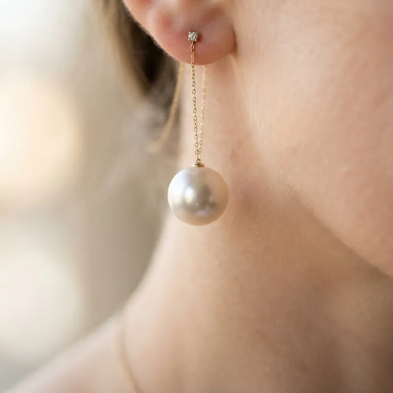

# 文生图提示词（6 条真实示例）

6 条文生图提示词，全部 18–23 个词。写法和文生视频完全不同：不谈镜头运动，只堆**主体 + 光线 + 材质 + 氛围**，最后用一个 `photoreal` 收口。

## 1. Raincoat Soft Neon


**画幅** 3:4　**词数** 19

```text
Beauty portrait in a translucent raincoat, soft neon bokeh, rain droplets as highlights, porcelain skin, romantic noir elegance, photoreal
```

## 2. Tea Light Hands


**画幅** 1:1　**词数** 22

```text
Intimate still life of elegant hands holding a glowing tea bowl, warm side light, linen and wood textures, wabi-sabi beauty, photoreal detail
```

## 3. Cliffside Linen Look


**画幅** 3:4　**词数** 23

```text
Full-body fashion image of a woman in ivory linen on a sunlit cliff, wind-lifted fabric, Mediterranean blue sea behind, airy summer beauty campaign
```

## 4. Mirror Light Study


**画幅** 3:4　**词数** 18

```text
Artistic beauty study: subject half-reflected in an antique mirror, soft window light, painterly yet photoreal, quiet elegant mood
```

## 5. Pearl Ear Macro



**画幅** 1:1　**词数** 18

```text
Extreme macro of a pearl earring against soft neck skin, creamy bokeh, jewelry beauty advertising, exquisite highlight control
```

## 6. Garden House Morning


**画幅** 16:9　**词数** 19

```text
Person reading by an open garden window in morning light, linen curtains, flowers soft-focused outside, lifestyle beauty photography, serene
```

---

[提示词写法拆解](../guide/prompt-patterns.md) · [文生视频提示词](text-to-video.md) · [回到首页](../README.md)
