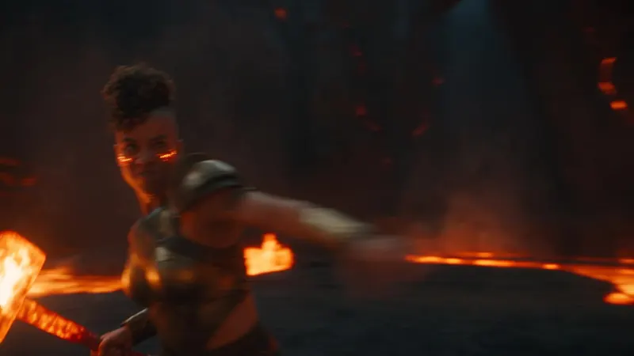
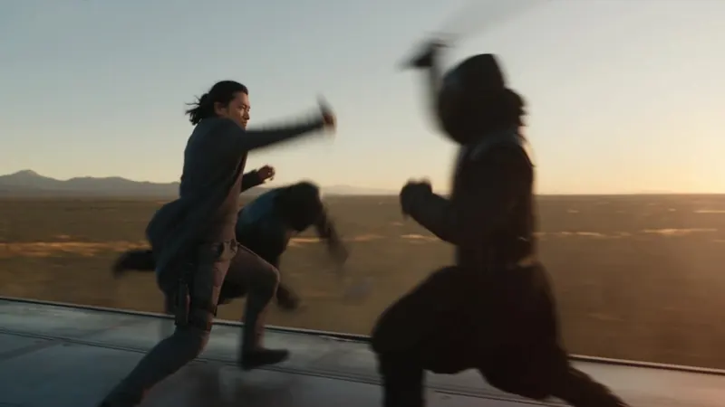
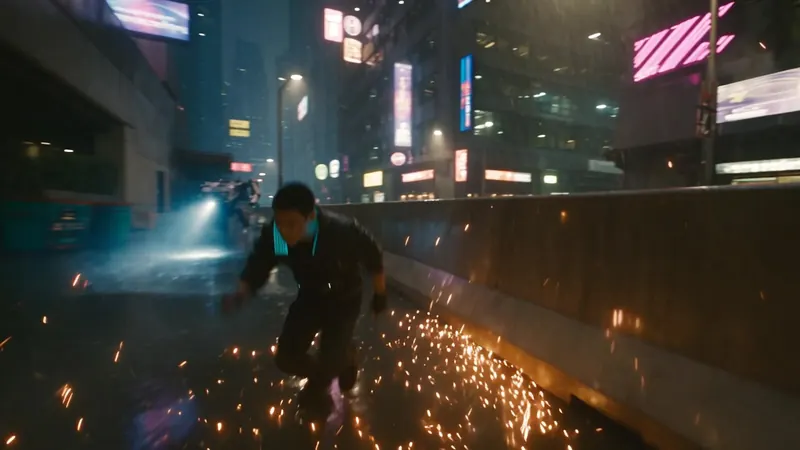
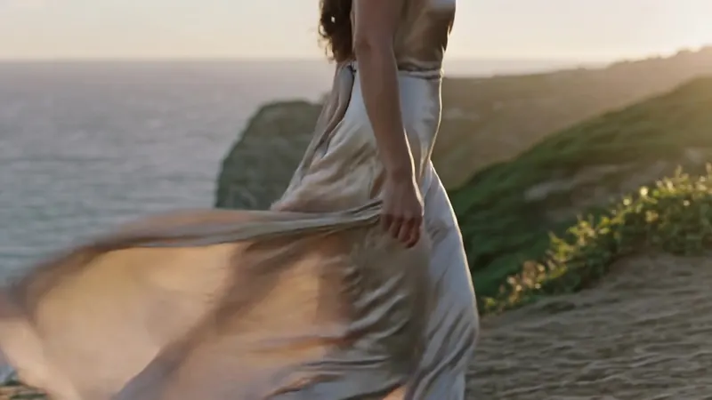
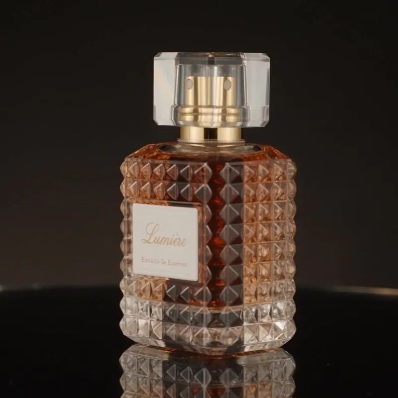
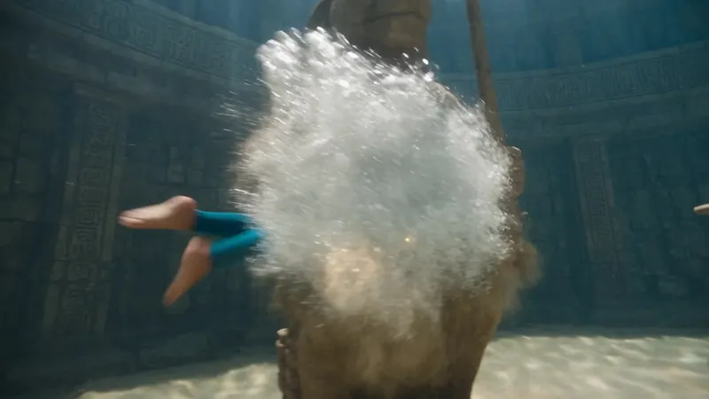

# 文生视频提示词（6 条真实示例）

这 6 条都是从 aiMakeVideo showcase 里原样取下来的提示词，对应画面可在站点复现。注意词数差别很大：4 条是 190 词上下的动作序列，2 条是 30 词左右的风格描述——两种写法都成立，取决于你要的是「一段戏」还是「一张会动的画」。

## 1. Volcano Forge Escape



**画幅** 16:9　**词数** 189

```text
Photoreal live-action fantasy escape through an active volcanic forge cavern, crisp high-resolution cinema detail, ember heat haze kept optically sharp, clean HDR contrast, one wide lens and one uninterrupted controlled handheld pursuit shot. The smith-mage is a muscular North African woman, late 20s, shaved sides with dense curls, glowing ember freckles, soot-streaked bronze armor over ash linen, one living molten hammer in her right hand. Keep one identical smith-mage throughout. Exactly 5 distinct lava constructs emerge; construct 5 is a towering slag titan with a chain-anvil. Never reuse a construct. Every hammer blow hits exactly one target. Show 5 separate contacts, cooled-glass shatters, freezes into dead stone. No multi-target smash. Each next construct blocks, hurls slag, or collapses a bridge. Rotate overhead forge strike, lateral quench-smash, vault over magma rivulet, ground-spike kick, and final titan knee break. Every relocation: micro-anticipation; orange-white forge flash hides her then reveals her already striking the next construct; camera keeps physical follow. No transit smear, no whip pan, no motion blur. Keep skin, armor, lava crust, particles sharp.

No dialogue or subtitles. Furnace roar, 5 quench-impact accents, rock collapses, flash cracks, industrial percussion sting.
```

## 2. Maglev Train Duel



**画幅** 16:9　**词数** 194

```text
Photoreal live-action modern wuxia duel atop a speeding maglev at golden hour, crisp high-resolution cinema detail, wind-whipped coat fabric, clean HDR contrast, one 40mm-equivalent lens and one uninterrupted controlled handheld tracking shot along the train roof. The duelist is a lean East Asian man, early 30s, sharp jaw, windblown black hair tied low, charcoal tailored coat over combat layers, one carbon-fiber jian in his right hand. Keep one identical duelist throughout. Exactly 6 distinct masked rivals climb onto the roof; rival 6 is a twin-blade captain. Never reuse a rival. Every cut lands on exactly one opponent. Show 6 separate contacts and individual falls off-frame. No multi-target slash. Each next rival lunges, binds, or forces the roof edge. Rotate descending cut, rising cut, bind-and-displace, reverse-grip draw, spinning deflection, and final disarm. Every relocation: micro-anticipation; pale steel flash hides him then reveals him already committed beside the next rival; camera keeps rolling with train landscape visible. No transit smear, no whip pan, no motion blur. Camera stays close with sidesteps and arcs toward each flash destination without snapping.

No dialogue or subtitles. Wind roar, rail hum, 6 blade accents, dry flash cracks, accelerating taiko-electronic sting.
```

## 3. Neon Rooftop Chase



**画幅** 16:9　**词数** 215

```text
Photoreal live-action cyberpunk chase at rainy night, crisp high-resolution cinema detail, wet asphalt reflections, clean HDR contrast, one 35mm-equivalent lens and one uninterrupted controlled handheld pursuit shot. The courier is a lean East Asian man in his mid-20s, cropped black hair with a cyan underlight edge, thin scar along the jawline, matte black riding jacket, fingerless gloves, compact magnetic satchel locked to his chest. Keep one identical courier throughout. He flees exactly 4 distinct armored drone-riders; each has a unique chassis silhouette and melee tool; rider 4 is a heavy enforcer with a telescoping stun lance. Never reuse a rider. Every near-miss and strike is one-to-one. Show 4 separate contact events: sparks, shattered plating, wipeouts. No multi-target hits. Each next rider actively cuts him off, rams, or grapples. Rotate vault, slide-under, wall-run, and final lance parry without adjacent repetition. Every relocation: micro-anticipation; a hard cyan strobe fully hides him and he vanishes; camera keeps physical follow with city visible; a second local strobe reveals him already in the next escape or attack pose. No transit smear, no whip pan, no motion blur. Camera stays close with smooth arcs and pivots toward each strobe destination without snapping.

No dialogue or subtitles. Night city ambience, tire hiss, 4 distinct impact accents, dry strobe cracks, accelerating synth hit.
```

## 4. Cliffside Silk Walk



**画幅** 16:9　**词数** 44

```text
A graceful woman in a flowing champagne silk dress walking along a cliffside path at golden hour, fabric catching wind, warm rim light on skin and hair, slow lateral tracking shot, 85mm look, shallow depth of field, refined beauty commercial, photoreal, subtle film grain
```

## 5. Lumière Perfume Orbit



**画幅** 1:1　**词数** 26

```text
Luxury perfume bottle on black glass, slow orbit, prism light splitting into soft spectral highlights, ultra-clean reflections, macro commercial beauty, razor-sharp label readable, elegant negative space
```

## 6. Underwater Temple Heist



**画幅** 16:9　**词数** 193

```text
Photoreal live-action underwater heist in crystal-clear sunlit water, crisp high-resolution cinema detail, volumetric godrays through a Mesoamerican stone temple arena, clean HDR contrast, one wide underwater housing lens and one uninterrupted controlled floating pursuit shot. The diver is a lean young man in his mid-20s, short dark hair under a glass half-helm, teal compression leggings with charcoal chest harness, one glowing relic cylinder on his left thigh. Keep one identical diver throughout. He faces exactly 5 distinct temple guardians, each with unique stone mask and weapon; guardian 5 is a gate warden with twin tridents. Never reuse a guardian. Every strike hits exactly one target. Show 5 separate contacts, sand bursts, collapses into rubble. No multi-target cut. Each next guardian actively intercepts or spears. Rotate dolphin-kick dash, barrel-roll dodge, knife thrust, heel smash, and final trident lock. Every relocation: micro-anticipation; a white-gold bubble burst flash hides him then reveals him mid-action beside the next guardian while camera keeps buoyant follow. No transit smear, no whip pan, no motion blur. Keep skin, bubbles, carved stone, particulate sharp.

No dialogue or subtitles. Muffled underwater tone, 5 stone-impact accents, bubble rushes, flash pops, rising percussion sting.
```

---

[提示词写法拆解](../guide/prompt-patterns.md) · [文生图提示词](text-to-image.md) · [回到首页](../README.md)
