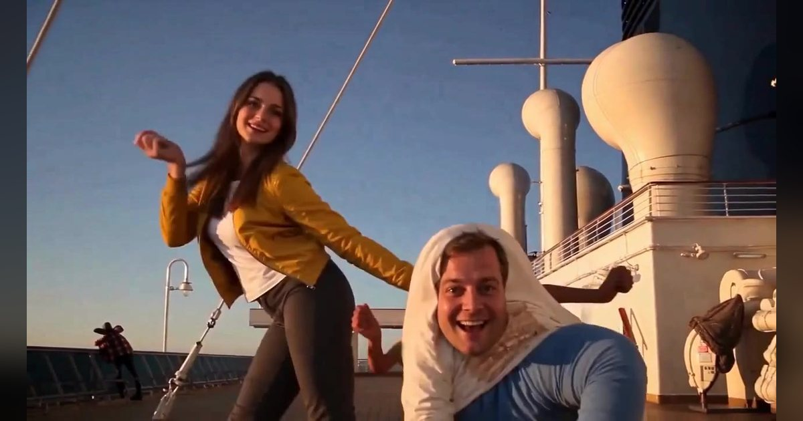

# 24K Magic AI 视频模板

1–2 张照片 → 夕阳下的游轮甲板群舞。你在船尾跟着跳，同伴发现墙上的红色箱子，最后用信号弹收尾。这个趋势也叫 Dracula cruise ship dance 或 Hotel Transylvania boat dance，来自 Raguler 把《精灵旅社 3》那段舞改编成的 AI 版，配曲是 Bruno Mars 的《24K Magic》。

> Dance on a sunset cruise deck while a friend finds the red wall case and ends it with a signal flare.

## 参数

| 项 | 值 |
|---|---|
| 输入 | 1 张照片（Solo）或 2 张（Full，每张一个成年人） |
| 时长 | Full 30 秒 / Solo 10 秒 |
| 画幅 | 16:9 横屏 · 720p |
| 场景 | 固定的游轮甲板，不能换 |
| 服装 | 来自照片 |
| 音频 | 参考片段的原音轨，或静音 |
| 提示词 | 不需要写 |

**消耗**

| 版本 | 消耗 |
|---|---|
| Solo（10 秒，1 人） | 800 积分 |
| Full（30 秒，2 人） | 1900 积分 |

## 两个角色

| 角色 | 站位 | 在视频里 |
|---|---|---|
| 领舞 | 甲板中间 | 整支舞的主角，必填 |
| 同伴 | 领舞旁边 | 发现红箱子、放信号弹；只有 Full 版本有 |

只有 Full 版本会出现同伴。只填领舞时就是 10 秒的 Solo。

## 画面顺序

1. 甲板上音乐起，领舞跟着节奏走位
2. 镜头扫过夕阳和海面
3. 同伴注意到墙上的红色箱子
4. 两人一起跳完副歌
5. 信号弹打上天，画面收尾

## 换得掉什么，换不掉什么

- **换得掉**：谁出镜（脸、发型、衣服都来自照片）、10 秒还是 30 秒、要不要声音
- **换不掉**：游轮、夕阳、红箱子、信号弹，以及整段舞的动作和分镜

## 上传照片前先看这几条

- 每张照片一个成年人：正脸、清晰、光线均匀，脸不被遮挡
- 衣服来自照片，所以腰部以上或全身照比大头自拍好；照片没拍到的部分会按同样风格补上
- 避开墨镜、口罩、帽檐压脸、重度滤镜和合照；也别用明星照或广告图，会被判侵权退回
- 不能是公众人物；上传时要勾选「已获得照片中人物的同意」
- 一般要等 10 分钟左右，可以关掉页面，做好的视频在 My videos 里

→ [在 aiMakeVideo 打开 24K Magic 模板](https://aimakevideo.com/24k-magic-ai)

## 相关模板

- [Stereo Love Funk](stereo-love-funk.md) —— 最多 9 个人的大群舞，15 秒
- [Gangnam Style](gangnam-style.md) —— 固定 3 个人，每人一段
- [Tiny Desk](tiny-desk.md) —— 最多 5 个人的办公室乐队

---

[← 回到模板总览](index.md) · [积分计算器](../calculator.html) · [照片准备指南](../guide/photo-prep.md)
