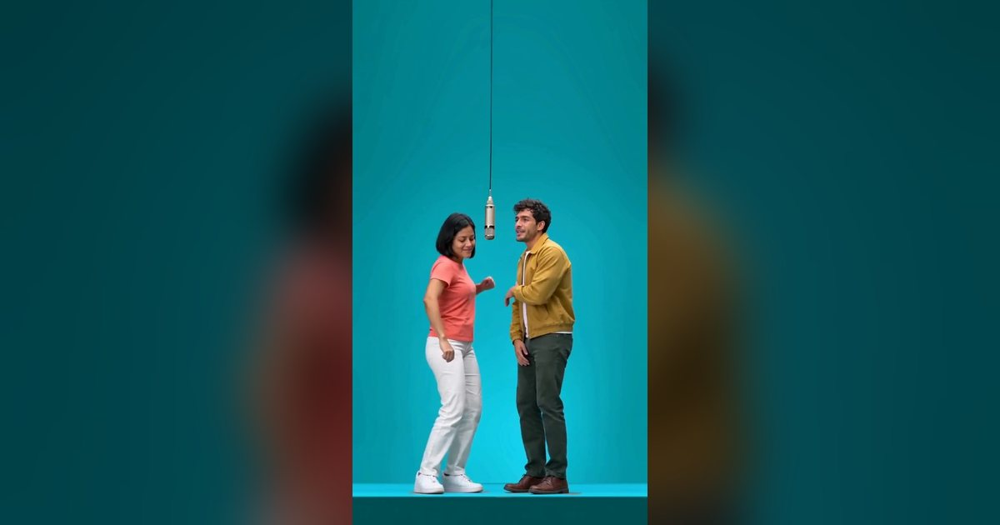

# 58th Floor AI 视频模板

1–2 张照片 → 青绿色背景的录音室里，两个人对着同一支吊麦轮流唱，硬切跟原片一样。原片是 Anderson .Paak 和 Cordae 的 COLORS 现场《58th Floor》。

> Two people trade verses at one hanging microphone on a teal studio set, with the same hard cuts.

## 参数

| 项 | 值 |
|---|---|
| 输入 | 1–2 张照片（只给一张时，同一个人演两边，像双胞胎） |
| 时长 | 15 秒或 30 秒 |
| 画幅 | 9:16 竖屏 · 720p |
| 场景 | 固定的青绿色录音室，不能换 |
| 服装 | 来自照片 |
| 音频 | 参考片段的原音轨，或静音 |
| 提示词 | 不需要写 |

**消耗**

| 版本 | 消耗 |
|---|---|
| 15 秒 | 900 积分 |
| 30 秒 | 1900 积分 |

## 两个角色

| 角色 | 站位 | 在视频里 |
|---|---|---|
| 左边 | 画面左侧 | 先开口的那位 |
| 右边 | 画面右侧 | 接后半段 |

只填一个角色时，同一张脸会演两边，不会换成 AI 替身。

## 画面顺序

1. 左边的人凑近吊麦开唱
2. 硬切到右边接词
3. 两人交替，镜头角度跟着切
4. 30 秒版本多一段，分镜不变

## 换得掉什么，换不掉什么

- **换得掉**：谁出镜、一个人还是两个人、15 秒还是 30 秒、要不要声音
- **换不掉**：录音室、吊麦、灯光和每一次硬切的位置

## 上传照片前先看这几条

- 每张照片一个成年人：正脸、清晰、光线均匀，脸不被遮挡
- 衣服来自照片，所以腰部以上或全身照比大头自拍好；照片没拍到的部分会按同样风格补上
- 避开墨镜、口罩、帽檐压脸、重度滤镜和合照；也别用明星照或广告图，会被判侵权退回
- 不能是公众人物；上传时要勾选「已获得照片中人物的同意」
- 一般要等 10 分钟左右，可以关掉页面，做好的视频在 My videos 里

→ [在 aiMakeVideo 打开 58th Floor 模板](https://aimakevideo.com/58th-floor-ai)

## 相关模板

- [Migos](migos.md) —— 两个人的 rap 对唱，10 秒
- [Hotel Lobby](hotel-lobby.md) —— 两个人的 rap，自带原创歌
- [Schooling Seniors](schooling-seniors.md) —— 一个人对着镜头 rap

---

[← 回到模板总览](index.md) · [积分计算器](../calculator.html) · [照片准备指南](../guide/photo-prep.md)
