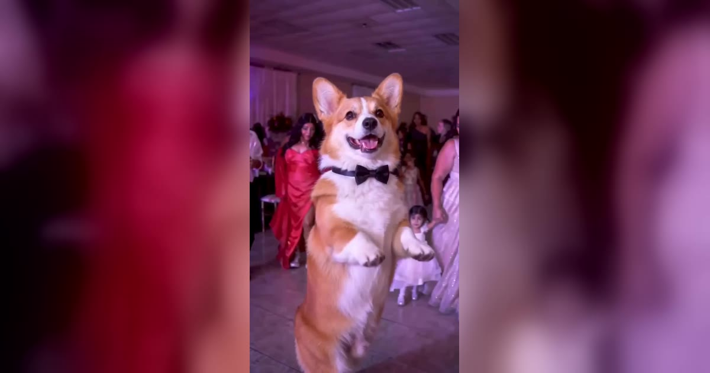

# Baby Wow AI 视频模板

一张照片 → 8 秒 BbY WOW 派对入场舞：你跳着走进人群，镜头一直跟着你。人和宠物都能跳。

> Upload one photo and become the dancer in the BbY WOW meme: an 8-second walk-in through the party with the camera on you.

## 参数

| 项 | 值 |
|---|---|
| 输入 | 1 张照片：一个人，或一只宠物 / 一个角色（最好是全身照） |
| 跳舞的是谁 | 人：脸、衣服、鞋来自照片；宠物或角色：狗、猫、玩偶、卡通形象都能直立着跳 |
| 时长 | 8 秒 |
| 画幅 | 9:16 竖屏 · 720p |
| 音频 | 参考片段的原音轨，或静音（发布时在 TikTok 里加 BbY WOW 的声音） |
| 提示词 | 不需要写 |

**消耗**

| 分辨率 | 消耗 |
|---|---|
| 720p | 600 积分 |

## Baby Wow 和 Dime Dime Baby 是什么关系

是同一个梗：歌名写作 BbY WOW，所以会看到 Baby Wow、BBY WOW、bby wow 几种写法；副歌最上口的一句是 "dime dime baby"（西班牙语「告诉我，告诉我，宝贝」），所以很多人也这样搜。网站上这两个页面都做同一个派对入场画面，[Dime Dime Baby](dime-dime-baby.md) 和这里都是 600 积分，按你习惯搜的名字选就行。

## 换得掉什么，换不掉什么

- **换得掉**：跳舞的是谁，人还是宠物；衣服和鞋（来自照片）；要不要声音
- **换不掉**：派对房间、两边的宾客、跟拍运镜、转身和走向镜头的动作、节奏

## 上传照片前先看这几条

- 全身照最好：人的话，脸、衣服和鞋都要拍到；宠物的话，脸、毛色、花纹和身上的配饰都会保留
- 传宠物照时，确认「跳舞的是谁」选的是「宠物或角色」
- 避开墨镜、重度滤镜和合照
- 人的照片必须是成年人，且不能是公众人物；上传时要勾选「已获得照片中人物的同意」

→ [在 aiMakeVideo 打开 Baby Wow 模板](https://aimakevideo.com/baby-wow-ai)

## 相关模板

- [Dime Dime Baby](dime-dime-baby.md) —— 同一个派对入场梗
- [Single Ladies Dog Dance](single-ladies-dog.md) —— 宠物站 C 位的三人舞
- [Toc Toc](toc-toc.md) —— 10 秒单人舞

---

[← 回到模板总览](index.md) · [积分计算器](../calculator.html) · [照片准备指南](../guide/photo-prep.md)
