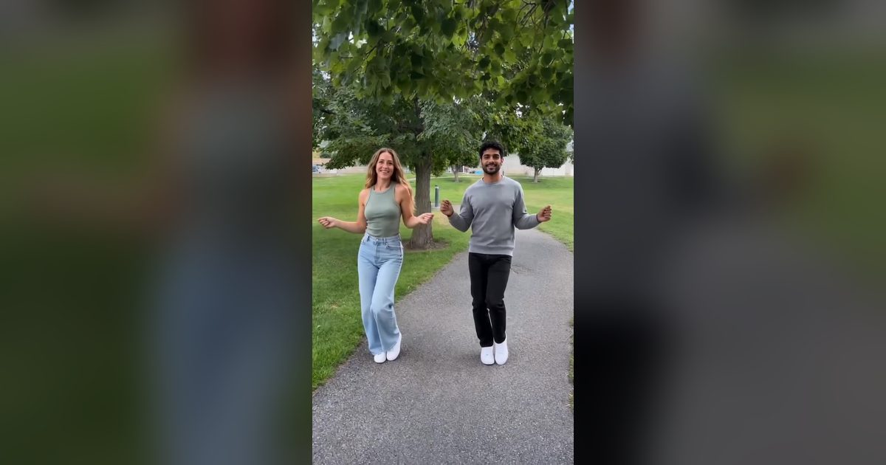

# Babydoll Dance AI 视频模板

1–2 张照片 → 15 秒：两个人并排，用手机手持拍，跳 Babydoll two step 的前 15 秒：原地弹跳、手臂松松地甩，抬膝、大步往两侧迈，在脸边甩一下手，踢腿，最后一只手臂高高扬起。三个地点可选：树下的公园小路（默认）、阳光下的小街，或者明亮的客厅。这个趋势也叫 Babydoll challenge，配乐是 Jamie Miller 的《Babydoll》，2026 年 8 月发行，10 月拿到英国单曲榜第一。只有一张照片时，另一位由固定的 AI 替身来跳。

> The bounce, the kicks, the arm up high, side by side.

## 参数

| 项 | 值 |
|---|---|
| 输入 | 1–2 张照片，每张一个成年人；第一张在左，第二张在右；只有一张时由固定的 AI 替身跳另一位 |
| 时长 | 15 秒 |
| 画幅 | 9:16 竖屏 · 720p |
| 场景 | 公园小路、阳光小街、明亮客厅，三选一；三个地点是同一套动作 |
| 服装 | 来自各自的照片 |
| 音频 | 趋势原曲，或静音 |
| 提示词 | 不需要写 |

**消耗**

| 版本 | 消耗 |
|---|---|
| 15 秒 | 800 积分 |

## 画面顺序

1. 两人并排原地弹跳，手臂随意甩动
2. 抬膝，大步往两侧迈
3. 在脸边甩一下手
4. 踢腿、换步
5. 一只手臂高高扬起收尾

## 换得掉什么，换不掉什么

- **换得掉**：谁出镜、左右位置、三个地点、有声还是静音
- **换不掉**：动作，以及手持手机的晃动

## 上传照片前先看这几条

- 每张照片一个成年人，正脸、清晰、光线均匀，最好拍到腰部以下
- 衣服来自各自的照片；只拍了上半身的话，会补上素色裤子和鞋
- 想左右站位对，就按左、右的顺序上传
- 避开墨镜、口罩、重度滤镜，以及明星照或剧照
- 照片的背景不会进视频
- 只限成年人；一般要等几分钟，做好的视频在 My videos 里

→ [在 aiMakeVideo 打开 Babydoll Dance 模板](https://aimakevideo.com/babydoll-dance-ai)

## 相关模板

- [Christmas Dance](christmas-dance.md) —— 双人并排的圣诞睡衣舞
- [Grease Dance](grease-dance.md) —— 双人全身同框，一张照片也能做
- [Toc Toc](toc-toc.md) —— 一张照片的单人舞

---

[← 回到模板总览](index.md) · [积分计算器](../calculator.html) · [照片准备指南](../guide/photo-prep.md)
