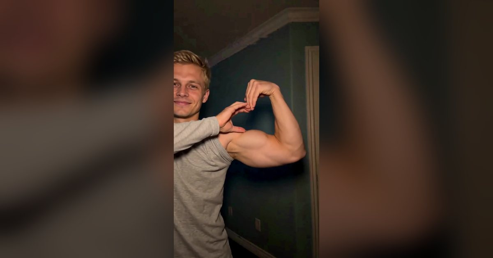

# Bicep Heart AI 视频模板

1 张照片（情侣版 2 张）→ 7 秒：撸起袖子，一只手臂发力，另一只手扣上去，两条手臂围成一个心形，最后得意地笑。这个姿势也叫 arm heart 或 muscle heart，2026 年 10 月底在 TikTok 和 X 上流行起来，没有明确的发起人。

> Flex one arm, curl the other hand against it, and hold the heart with a proud grin.

## 参数

| 项 | 值 |
|---|---|
| 输入 | 1 张照片；情侣版 2 张，每张一个成年人 |
| 时长 | 7 秒 |
| 画幅 | 9:16 竖屏 · 720p |
| 场景 | 固定，不能换 |
| 服装 | 来自照片 |
| 音频 | 参考片段的原音轨，或静音 |
| 提示词 | 不需要写 |

**消耗**

| 版本 | 消耗 |
|---|---|
| Solo 或情侣版 | 500 积分（同价） |

## 两个版本

| 角色 | 站位 | 在视频里 |
|---|---|---|
| Solo | 正对镜头 | 一个人自己比出心形 |
| 情侣版 | 一前一后 | 一个人在上方发力，另一个把心形合在自己脸旁 |

只有人物版本，宠物照片不适用。

## 画面顺序

1. 撸起袖子，对镜头抬手
2. 一只手臂发力
3. 另一只手扣上来，两臂合成心形
4. 定住，露出得意的笑

## 换得掉什么，换不掉什么

- **换得掉**：一个人还是情侣版、谁出镜、要不要声音
- **换不掉**：动作顺序、机位和 7 秒的节奏

## 上传照片前先看这几条

- 这是全站最便宜的模板之一，适合先拿它试一张照片的效果
- 每张照片一个成年人：正脸、清晰、光线均匀，脸不被遮挡
- 衣服来自照片，所以腰部以上或全身照比大头自拍好；照片没拍到的部分会按同样风格补上
- 避开墨镜、口罩、帽檐压脸、重度滤镜和合照；也别用明星照或广告图，会被判侵权退回
- 不能是公众人物；上传时要勾选「已获得照片中人物的同意」
- 一般要等 10 分钟左右，可以关掉页面，做好的视频在 My videos 里

→ [在 aiMakeVideo 打开 Bicep Heart 模板](https://aimakevideo.com/bicep-heart-ai)

## 相关模板

- [Dime Dime Baby](dime-dime-baby.md) —— 一张照片的 8 秒入场
- [Funk Loading](funk-loading.md) —— 一张照片的 8 秒派对入场
- [Toc Toc](toc-toc.md) —— 一张照片的 10 秒单人舞

---

[← 回到模板总览](index.md) · [积分计算器](../calculator.html) · [照片准备指南](../guide/photo-prep.md)
