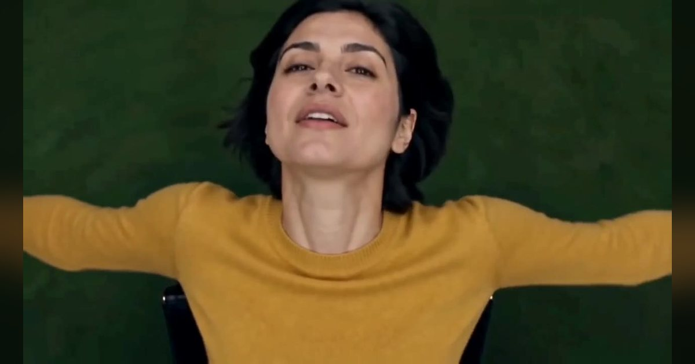

# Birds of a Feather AI 视频模板

1 张照片 → 13 秒：你靠在一把办公椅上，椅子在铺着绿地毯的木墙房间里打转、滑行，镜头从门口、正上方和地板三个角度拍你，你轻声对着镜头唱。原型是 Billie Eilish《Birds of a Feather》MV（2024 年 9 月，导演 Aidan Zamiri）里的转椅片段，AI 版从 2026 年 10 月底在 TikTok 流行。

> Lean back on an office chair that drifts and spins through a wood-panelled room, singing up at the lens.

## 参数

| 项 | 值 |
|---|---|
| 输入 | 1 张照片，一个成年人 |
| 时长 | 13 秒 |
| 画幅 | 16:9 横屏 · 720p |
| 场景 | 固定的木墙房间，不能换 |
| 服装 | 来自照片 |
| 音频 | 参考片段的原音轨，或静音 |
| 提示词 | 不需要写 |

**消耗**

| 版本 | 消耗 |
|---|---|
| 13 秒 | 900 积分 |

## 画面顺序

1. 门口的角度：你靠在椅子上，椅子开始滑
2. 正上方俯拍，椅子转起来
3. 贴着地板的低机位
4. 你抬头对着镜头轻声唱，椅子停下

## 换得掉什么，换不掉什么

- **换得掉**：谁出镜、要不要声音
- **换不掉**：房间、绿地毯、椅子的轨迹和三个机位的顺序

## 上传照片前先看这几条

- 每张照片一个成年人：正脸、清晰、光线均匀，脸不被遮挡
- 衣服来自照片，所以腰部以上或全身照比大头自拍好；照片没拍到的部分会按同样风格补上
- 避开墨镜、口罩、帽檐压脸、重度滤镜和合照；也别用明星照或广告图，会被判侵权退回
- 不能是公众人物；上传时要勾选「已获得照片中人物的同意」
- 一般要等 10 分钟左右，可以关掉页面，做好的视频在 My videos 里

→ [在 aiMakeVideo 打开 Birds of a Feather 模板](https://aimakevideo.com/birds-of-a-feather-ai)

## 相关模板

- [Ice Ice Baby](ice-ice-baby.md) —— 两个人的同步舞，11 秒
- [Vossi Bop](vossi-bop.md) —— 一个人在桥上 rap，镜头绕圈
- [Thriller Dance](thriller-dance.md) —— 一张照片领舞丧尸群

---

[← 回到模板总览](index.md) · [积分计算器](../calculator.html) · [照片准备指南](../guide/photo-prep.md)
