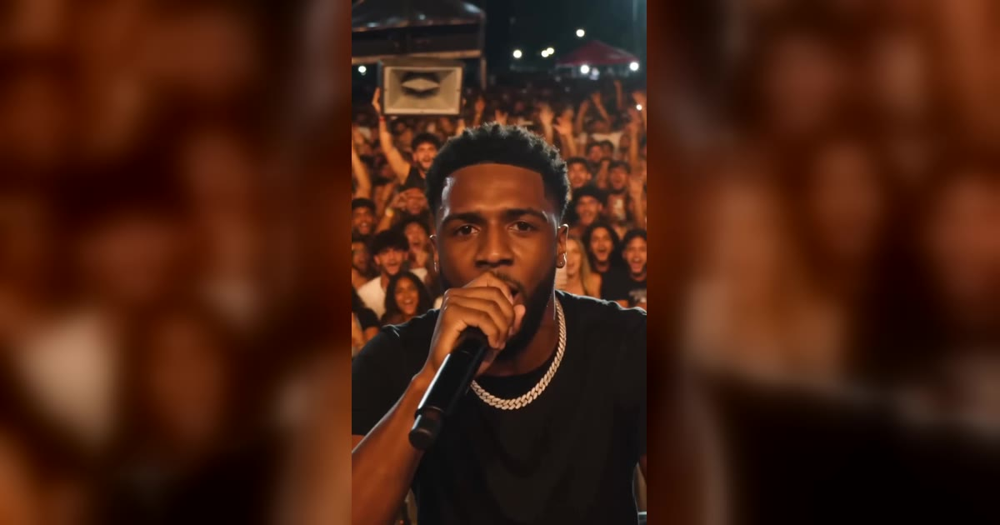

# Bulin 47 AI 视频模板

一张正面人像照片 → 15 秒 freestyle rap 表演视频。

> Freestyle rap trend: upload one photo and get a 15-second video of that person, pet or character performing a freestyle rap on a packed stage.

## 参数

| 项 | 值 |
|---|---|
| 输入 | 1 张照片（单人、正脸、脸完全可见） |
| 时长 | 15 秒 |
| 画幅 | 9:16 竖屏 / 16:9 横屏 |
| 音频 | 原声，已合成在视频里 |
| 提示词 | 不需要写 |

**消耗**

| 分辨率 | 消耗 |
|---|---|
| 480p | 465 积分 |
| 720p | 1023 积分 |

## 换得掉什么，换不掉什么

- **换得掉**：人物、宠物、角色的脸和外形
- **换不掉**：舞台、镜头、节奏（都来自固定的参考片段）

## 上传照片前先看这几条

- 每张照片里只能有一个人（双人模板也可以只给一张双人合照）
- 正脸、光线均匀、脸完全不被遮挡
- 必须是成年人，且不能是公众人物
- 上传时要勾选「已获得照片中人物的同意」——这条是硬性要求

→ [在 aiMakeVideo 打开 Bulin 47 模板](https://aimakevideo.com/bulin-47-ai)

---

[← 回到模板总览](index.md) · [积分怎么算](../credits.md)
