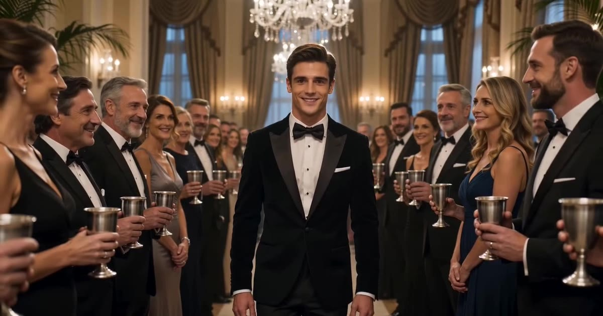

# Burning Bridges AI 视频模板

一张照片 → 15 秒横屏派对场景，你在吊灯下当主人。

> Party-scene trend: a silent 15-second widescreen video of that person, pet or character hosting a chandelier-lit party.

## 参数

| 项 | 值 |
|---|---|
| 输入 | 1 张照片（半身或全身都行） |
| 时长 | 15 秒 |
| 画幅 | 16:9 横屏 |
| 音频 | 静音，发布时自己配 |
| 提示词 | 不需要写 |

**消耗**

| 分辨率 | 消耗 |
|---|---|
| 480p | 465 积分 |
| 720p | 1023 积分 |

## 换得掉什么，换不掉什么

- **换得掉**：人物、宠物、角色
- **换不掉**：场景、灯光、镜头

## 上传照片前先看这几条

- 每张照片里只能有一个人（双人模板也可以只给一张双人合照）
- 正脸、光线均匀、脸完全不被遮挡
- 必须是成年人，且不能是公众人物
- 上传时要勾选「已获得照片中人物的同意」——这条是硬性要求

→ [在 aiMakeVideo 打开 Burning Bridges 模板](https://aimakevideo.com/burning-bridges-ai)

## 相关模板

- [Zombie](zombie.md) —— 12 秒剧情
- [Stereo Love Funk](stereo-love-funk.md) —— 多人同框，最多 9 张
- [Ozil Goal](ozil-goal.md) —— 单人照片做动作镜头

---

[← 回到模板总览](index.md) · [积分计算器](../calculator.html) · [照片准备指南](../guide/photo-prep.md)
