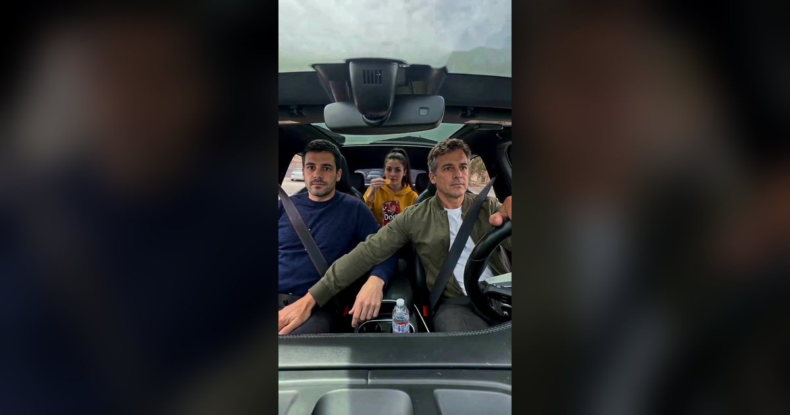

# Careless Whisper Car AI 视频模板

1–3 张照片 → 11 秒行车记录仪视角的车内小品：后座伸手偷薯片，司机没看就去摸袋子，手落在副驾的腿上，三个人同时僵住，萨克斯响起。这个梗也叫 stolen chips car meme、three guys in a car meme 或 hand on thigh car meme，配乐是 George Michael 1984 年的《Careless Whisper》（英国冠军单曲，萨克斯由 Steve Gregory 吹奏）。AI 换脸版 2026 年 11 月初在 Instagram 和 TikTok 流行。

> A dash-cam car skit: the back seat steals the chips, the driver lands a hand on the wrong leg, and everyone freezes to the sax.

## 参数

| 项 | 值 |
|---|---|
| 输入 | 1–3 张照片，每张一个成年人。司机必填，空位由固定的 AI 替身来演 |
| 时长 | 11 秒 |
| 画幅 | 9:16 竖屏 · 720p |
| 场景 | 固定的停着的车，不能换 |
| 服装 | 来自照片 |
| 音频 | 萨克斯原曲，或静音 |
| 提示词 | 不需要写 |

**消耗**

| 版本 | 消耗 |
|---|---|
| 11 秒 | 800 积分（填 1 个还是 3 个人都一样） |

## 三个座位

| 角色 | 站位 | 在视频里 |
|---|---|---|
| 司机 | 左前 | 必填。伸手去摸薯片袋 |
| 副驾 | 右前 | 被摸到腿的那位 |
| 后座 | 两个前排座椅中间 | 偷薯片的人 |

谁都不会换座位。空着的位子由固定的 AI 替身来演。

## 画面顺序

1. 三个人坐在车里，画面是行车记录仪的角度
2. 后座的手伸过来，抓走薯片
3. 司机没看，手伸向袋子的位置
4. 手落在副驾的腿上
5. 三个人同时僵住，萨克斯进来

## 换得掉什么，换不掉什么

- **换得掉**：谁坐哪个位子、填几个人、要不要声音
- **换不掉**：车、座位布局、偷薯片和摸错腿的时间点

## 上传照片前先看这几条

- 脸最清楚的那张放司机，这个角色的近景最多
- 每张照片一个成年人：正脸、清晰、光线均匀，脸不被遮挡
- 衣服来自照片，所以腰部以上或全身照比大头自拍好；照片没拍到的部分会按同样风格补上
- 避开墨镜、口罩、帽檐压脸、重度滤镜和合照；也别用明星照或广告图，会被判侵权退回
- 不能是公众人物；上传时要勾选「已获得照片中人物的同意」
- 一般要等 10 分钟左右，可以关掉页面，做好的视频在 My videos 里

→ [在 aiMakeVideo 打开 Careless Whisper Car 模板](https://aimakevideo.com/careless-whisper-car-meme-ai)

## 相关模板

- [Coffee Making](coffee-making.md) —— 两个人的厨房翻车，13 秒
- [Hop Hop Hop](hop-hop-hop.md) —— 两个人的错位搞笑，8 秒
- [Fancy Cafe](fancy-cafe.md) —— 两个人的咖啡馆尴尬，19 秒

---

[← 回到模板总览](index.md) · [积分计算器](../calculator.html) · [照片准备指南](../guide/photo-prep.md)
