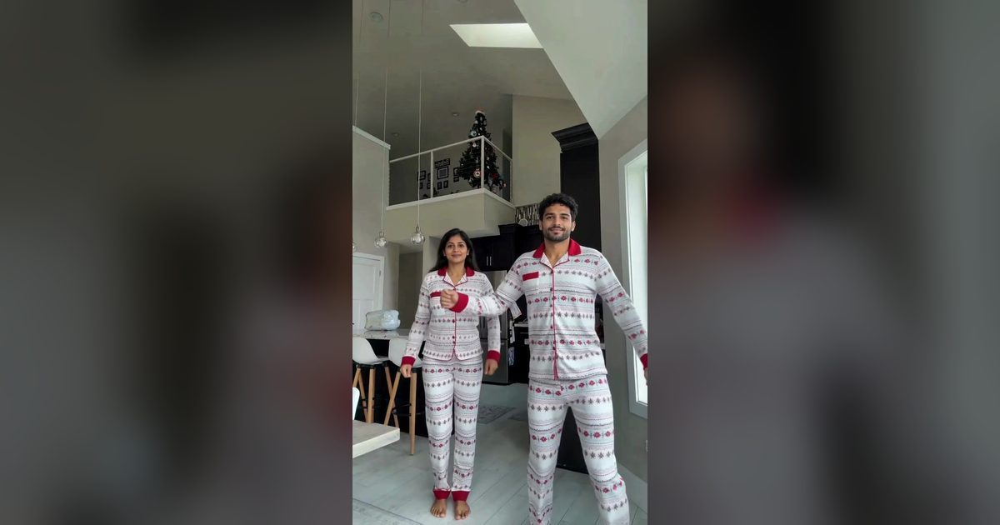

# Christmas Dance AI 视频模板

1–2 张照片 → 15 秒：两个人并排站在一部固定的手机前，跟着一段圣诞歌串烧跳同样几个动作，就是 2026 年 11 月流行的圣诞睡衣舞。两个场景：Kitchen PJs 是明亮的厨房，阳台上一棵亮着灯的圣诞树，两人穿配套的红白费尔岛花纹睡衣，中间有一个转圈换位；Plaid Pants 是一间空白房间，黑 T 恤配格子睡裤，有握手、抬膝和捂脸。只有一张照片时，另一位由固定的 AI 替身来跳。

> Matching pajamas, a phone that never moves, the same moves side by side.

## 参数

| 项 | 值 |
|---|---|
| 输入 | 1–2 张照片，每张一个成年人；只有一张时由固定的 AI 替身跳另一位，每次都是同一个人，不像任何明星 |
| 时长 | 15 秒 |
| 画幅 | 9:16 竖屏 · 720p |
| 场景 | Kitchen PJs（厨房）或 Plaid Pants（白房间），二选一 |
| 服装 | 场景配套的圣诞睡衣（默认），或照片里自己的衣服 |
| 音频 | 趋势原配乐，或静音 |
| 提示词 | 不需要写 |

**消耗**

| 版本 | 消耗 |
|---|---|
| 15 秒 | 900 积分 |

## 画面顺序

1. 两个人并排站好，手机固定不动，从头拍到脚
2. 跟着串烧做同样的几个动作
3. 厨房版：中间转一圈，两人互换位置
4. 白房间版：握手、抬膝，最后用手捂住脸

## 换得掉什么，换不掉什么

- **换得掉**：谁出镜、哪个场景、穿睡衣还是自己的衣服、有声还是静音
- **换不掉**：动作、固定机位、房间布置

## 上传照片前先看这几条

- 舞蹈是隔几步从头拍到脚的，正脸清楚、能拍到腰部以下的照片最好
- 选圣诞睡衣时，照片只决定脸、发型和体型；选自己的衣服时，衣服来自各自的照片
- 每张照片一个成年人；避开墨镜、口罩、重度滤镜、合照，以及明星照或剧照
- 照片的背景不会进视频
- 只限成年人；一般要等几分钟，做好的视频在 My videos 里

→ [在 aiMakeVideo 打开 Christmas Dance 模板](https://aimakevideo.com/christmas-dance-ai)

## 相关模板

- [Christmas](christmas.md) —— 一张照片变跳舞的精灵，或者让监控「拍到」圣诞老人
- [Babydoll Dance](babydoll-dance.md) —— 另一支双人并排的舞
- [Grease Dance](grease-dance.md) —— 双人全身同框的经典舞

---

[← 回到模板总览](index.md) · [积分计算器](../calculator.html) · [照片准备指南](../guide/photo-prep.md)
