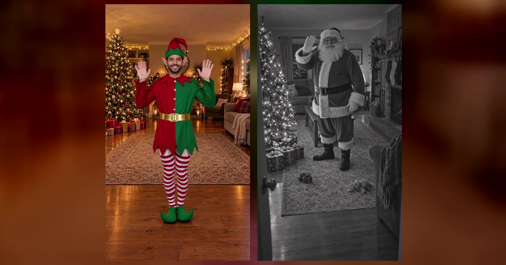

# Christmas AI 视频模板

一个页面两种圣诞视频：一张照片变成跳舞的圣诞精灵（15 秒），或者让家里的监控「拍到」圣诞老人来送礼物（10 秒）。

> Turn one photo into a dancing Christmas elf, or catch Santa leaving presents on your own home camera. No filming, no costume, ready in a few minutes.

## 两种视频

| 项 | Elf Dance 精灵舞 | Santa Cam 圣诞老人监控 |
|---|---|---|
| 输入 | 1 张照片（一个成年人，正脸清楚） | 1 张空房间或家门口的照片，**不需要任何人的照片** |
| 内容 | 先穿着自己的衣服出场，一阵金色光点后换上整套精灵装（条纹帽、尖耳朵、翘头鞋），蹦跳、小跑、转圈，最后对镜头眨眼 | 圣诞老人踮脚走进你拍的房间（或走到家门口），放下礼物，发现镜头后挥手 |
| 时长 | 15 秒 | 10 秒 |
| 画幅 | 9:16 竖屏 · 720p | 9:16 竖屏 · 720p |
| 场景 | 6 个预设（客厅、雪中小镇、玩具工坊、圣诞集市、木屋、城市广场），或上传自己的空场景照片 | 就是你上传的房间，画面里的东西保持原样 |
| 画面 | 彩色 | 默认夜视黑白（像真的家庭监控），也可以选彩色 |
| 音频 | 自制的铃儿响叮当编曲（公有领域旋律，不是现成歌曲），或静音 | 安静的夜晚环境音和隐约的雪橇铃声 |
| 提示词 | 不需要写 | 不需要写 |

**消耗**

| 视频 | 消耗 |
|---|---|
| Elf Dance · 15 秒 | 800 积分 |
| Santa Cam · 10 秒 | 600 积分 |

## 换得掉什么，换不掉什么

- **换得掉**：精灵是谁、在哪跳、要不要音乐；圣诞老人去谁家、彩色还是夜视
- **换不掉**：精灵的变装和舞步、圣诞老人放礼物再挥手的整套动作、镜头和节奏

## 上传照片前先看这几条

**Elf Dance**
- 一个成年人，正脸、清晰、光线均匀，最好拍到腰部以上或全身
- 脸、发型和体型保持你自己的，服装由模板换上
- 用自己的场景时，上传一张**胸口高度拍的空场景照片**，前面留一点地面

**Santa Cam**
- 照片里**不能有人**；房间整洁、开几盏灯效果最好
- 站在房间一角把手机举高往下拍，像家庭监控的视角；把圣诞树或壁炉拍进去，前面留出空地，让圣诞老人有地方蹲下放礼物
- 拍家门口的话，从门上方往下拍门口的地垫；清晰的门铃摄像头截图也可以用
- 孩子不用出镜，只需要看——适合圣诞早上给孩子一个惊喜

两种都要勾选「已获得照片中人物的同意」；Elf Dance 只接受成年人照片，且不能是公众人物。

→ [在 aiMakeVideo 打开 Christmas 模板](https://aimakevideo.com/christmas-ai)

## 相关模板

- [Thriller Dance](thriller-dance.md) —— 万圣节，一张照片领舞丧尸群
- [Zombie](zombie.md) —— 万圣节，两张照片的丧尸爱情故事
- [WYW My Sweetie](wyw-my-sweetie.md) —— 同样可选场景的单人舞

---

[← 回到模板总览](index.md) · [积分计算器](../calculator.html) · [照片准备指南](../guide/photo-prep.md)
