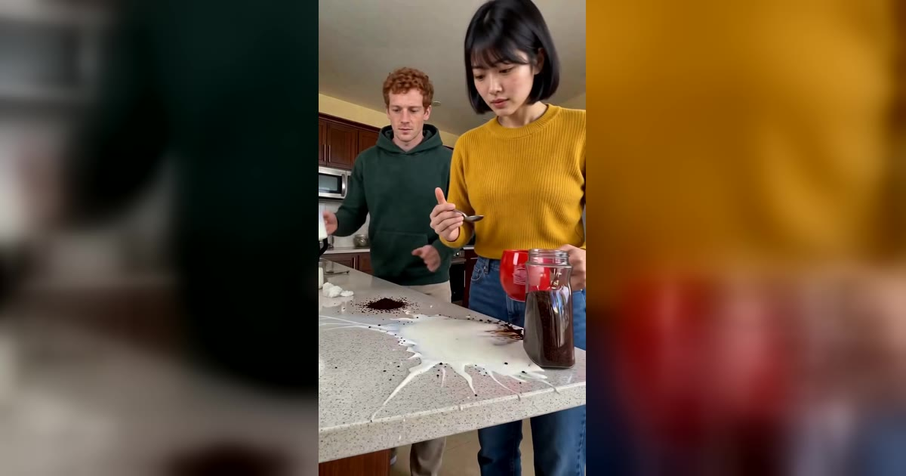

# Coffee Making AI 视频模板

1–2 张照片 → 13 秒面无表情的厨房翻车：两勺咖啡都撒在台面上，水倒进空杯子，牛奶落下时杯子刚好被端走。这个趋势也叫 Couple Coffee Mess、Couples Coffee Making 或 Coffee Couple。

> Put two people into the deadpan kitchen clip everyone is remaking. Both spoonfuls land on the counter, the water goes into an empty mug, and the milk comes down just after the mug is lifted away.

## 参数

| 项 | 值 |
|---|---|
| 输入 | 1–2 张照片，每张一个成年人（只给一张时，AI 替身演另一个角色） |
| 时长 | 13 秒 |
| 画幅 | 9:16 竖屏 · 720p |
| 场景 | 固定的厨房，不能换 |
| 服装 | 来自照片 |
| 音频 | 参考片段的原音轨，或静音（发布时自己配乐） |
| 提示词 | 不需要写 |

**消耗**

| 分辨率 | 消耗 |
|---|---|
| 720p | 900 积分（一张还是两张照片、有没有声音都同价） |

## 两个角色

| 角色 | 站位 | 在视频里 |
|---|---|---|
| 勺子和罐子 | 右前方 | 舀咖啡，把杯子端走，近景最多 |
| 水壶和牛奶 | 左后方 | 负责倒水和倒牛奶 |

脸最清楚的那张照片放在「勺子和罐子」，这个角色的近景最多。

## 每一秒发生什么

| 时间 | 画面 |
|---|---|
| 0–1 秒 | 从罐子里舀一勺，第一勺落在台面上，没进杯子 |
| 1–3.5 秒 | 水壶往空杯子里倒水 |
| 2–4 秒 | 两人面无表情地对视 |
| 5–7 秒 | 再舀一勺，第二勺撒在杯子另一边 |
| 8–9.5 秒 | 左边的人往后一靠，盯着天花板 |
| 10.5–11 秒 | 右边的人把杯子端走 |
| 11–13 秒 | 牛奶落在空出来的台面上，溅开；两人对视 |

## 换得掉什么，换不掉什么

- **换得掉**：谁出镜（脸、发型和衣服都来自照片）、一个人还是两个人、要不要声音
- **换不掉**：厨房、杯子、罐子、水壶、每一次撒漏的时间和位置。翻车本身就是这个趋势的笑点，所以都是固定的

目前只有人物版。两只金毛做咖啡的 Dog Coffee Fail 不在这个模板里。

## 上传照片前先看这几条

- 每张照片一个成年人：正脸、清晰、光线均匀、脸不被遮挡
- 衣服来自照片，所以腰部以上或全身照比自拍好；照片没拍到的部分，会按同样的日常风格补上
- 避开墨镜、口罩、重度滤镜和合照
- 不能是公众人物；上传时要勾选「已获得照片中人物的同意」
- 一般要等 10 分钟左右，可以关掉页面，做好的视频在 My videos 里

→ [在 aiMakeVideo 打开 Coffee Making 模板](https://aimakevideo.com/coffee-making-ai)

## 相关模板

- [Hop Hop Hop](hop-hop-hop.md) —— 同样是两个人的搞笑短片，8 秒
- [Grease Dance](grease-dance.md) —— 两个人的复古双人舞
- [Zombie](zombie.md) —— 两张照片的双人故事

---

[← 回到模板总览](index.md) · [积分计算器](../calculator.html) · [照片准备指南](../guide/photo-prep.md)
