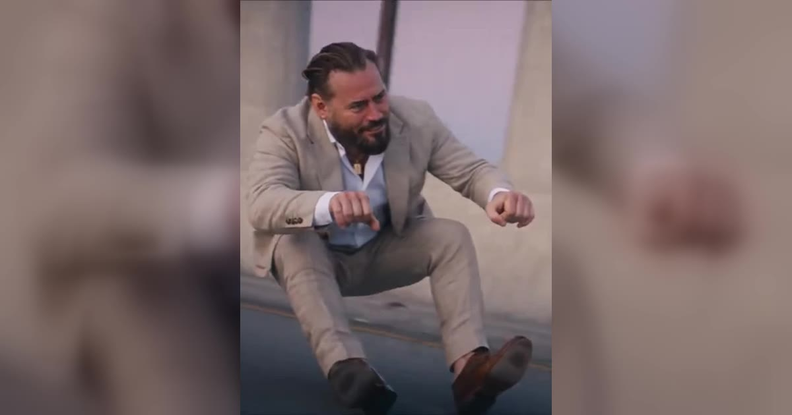

# Crazy Frog AI 视频模板

一张照片 → 15 秒骑隐形摩托的追逐镜头。

> One photo in, one invisible-moped hero out. The place and the people change; the ride, the flip and the chase are fixed.

## 参数

| 项 | 值 |
|---|---|
| 输入 | 1 张照片（可选再加一张追击角色） |
| 时长 | 15 秒 |
| 画幅 | 16:9（默认）/ 9:16 |
| 音频 | 可保留原声，也可静音 |
| 提示词 | 不需要写 |

**消耗**

| 分辨率 | 消耗 |
|---|---|
| 720p | 650 积分 |

**可选风格 / 场景**：Neon city night、Sunset overpass 等预设地点，也可以自定义

## 换得掉什么，换不掉什么

- **换得掉**：人物、场景（多个预设地点，也可以自己写）
- **换不掉**：骑行、后空翻、追逐的动作与镜头

## 上传照片前先看这几条

- 每张照片里只能有一个人（双人模板也可以只给一张双人合照）
- 正脸、光线均匀、脸完全不被遮挡
- 必须是成年人，且不能是公众人物
- 上传时要勾选「已获得照片中人物的同意」——这条是硬性要求

→ [在 aiMakeVideo 打开 Crazy Frog 模板](https://aimakevideo.com/crazy-frog-ai)

---

[← 回到模板总览](index.md) · [积分怎么算](../credits.md)
