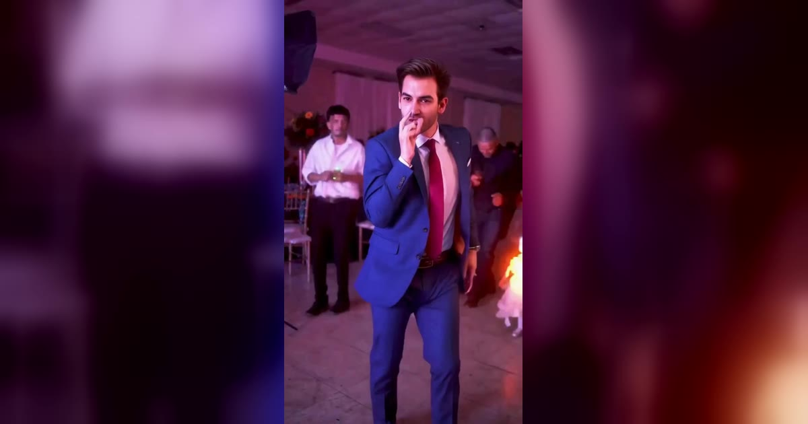

# Dime Dime Baby AI 视频模板

一张照片 → 8 秒婚礼派对入场舞，镜头跟着你穿过整个宴会厅。人和宠物都能跳。

> One photo puts you in the 8-second wedding-party dance everyone is posting: the camera follows you through the room, past the guests and the woman in red, and you own the entrance.

## 参数

| 项 | 值 |
|---|---|
| 输入 | 1 张照片：一个人，或一只宠物 / 一个角色（最好是全身照） |
| 跳舞的是谁 | 人：脸、衣服、鞋来自照片；宠物或角色：狗、猫、玩偶、卡通形象都能直立着跳 |
| 时长 | 8 秒 |
| 画幅 | 9:16 竖屏 · 720p |
| 音频 | 参考片段的原音轨，或静音（发布时在 TikTok 里加热门音乐） |
| 提示词 | 不需要写 |

**消耗**

| 分辨率 | 消耗 |
|---|---|
| 720p | 550 积分（人和宠物同价） |

## 换得掉什么，换不掉什么

- **换得掉**：跳舞的是谁，人还是宠物；衣服和鞋（来自照片，不是模板给的）；要不要声音
- **换不掉**：宴会厅、两边的宾客、后面穿红裙子的女人、转身和走向镜头的动作、跟拍运镜和节奏

## 上传照片前先看这几条

- 全身照最好：人的话，脸、衣服和鞋都要拍到；宠物的话，脸、毛色、花纹都会保留
- 上传后页面会预选「人」还是「宠物或角色」，选错了可以手动改，**传宠物照时一定确认选的是宠物**
- 避开墨镜、重度滤镜和合照
- 人的照片必须是成年人，且不能是公众人物；上传时要勾选「已获得照片中人物的同意」

→ [在 aiMakeVideo 打开 Dime Dime Baby 模板](https://aimakevideo.com/dime-dime-baby-ai)

## 相关模板

- [Toc Toc](toc-toc.md) —— 10 秒单人舞，可选房间
- [Bulin 47](bulin-47.md) —— 单人、宠物、角色都能用
- [Burning Bridges](burning-bridges.md) —— 吊灯派对场景，宠物也行

---

[← 回到模板总览](index.md) · [积分计算器](../calculator.html) · [照片准备指南](../guide/photo-prep.md)
