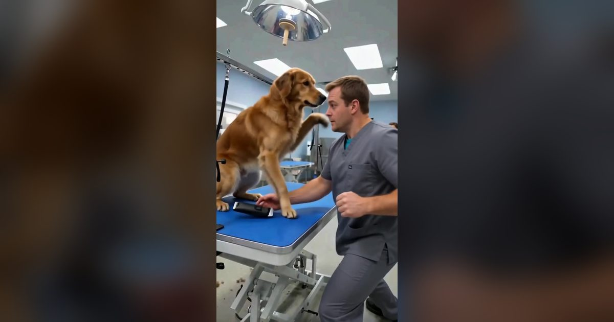

# Dog Grooming Time AI 视频模板

1 张宠物照 → 10 秒：你家狗狗像功夫片一样从美容台上杀出来，把第一个美容师摔在台上、踹进笼子，跟第二个美容师过招，再把对方按在台上，最后一个特写是美容师的头发被推子推掉。这个趋势叫「my dog when it's grooming time」，也叫 Groomer vs Dog，是 2026 年 11 月流行的 AI 片段。两个版本按狗的体型选：Big dog 是最早那条德牧原版，Small dog 是小型犬版，节奏一样。视频是 AI 做的，不是真实画面。

> Your dog versus two groomers, one take, kung fu rules.

## 参数

| 项 | 值 |
|---|---|
| 输入 | 1 张宠物照；可选再加 1–2 张人的照片当美容师 |
| 时长 | 10 秒 |
| 画幅 | 9:16 竖屏 · 720p |
| 场景 | Big dog（德牧原版）或 Small dog（小型犬版） |
| 美容师 | 不加照片就用片子里的 AI 美容师；加了照片的人会穿上片子里的工作服 |
| 音频 | 片子原声（撞击声、狗叫、推子声），或静音 |
| 提示词 | 不需要写 |

**消耗**

| 版本 | 消耗 |
|---|---|
| 10 秒 | 700 积分 |

## 画面顺序

1. 宠物在美容台上坐起，扑起来把第一个美容师脸朝下摔在台上
2. 一脚把对方踹飞，镜头甩过去，人飞进笼子
3. 第二个美容师冲进来摆开架势：出爪、闪躲、格挡
4. 宠物跳起来，把第二个美容师脸朝下按在台上
5. 特写：爪子按在对方头上，一只手拿推子推过他的头发

## 换得掉什么，换不掉什么

- **换得掉**：哪只宠物、大狗版还是小狗版、两个美容师要不要换成你或朋友、有声还是静音
- **换不掉**：美容室、动作和一镜到底的手持镜头

## 上传照片前先看这几条

- 宠物照：一张一只，清晰、光线好，至少拍到头和胸，最好是全身
- 照片里有项圈或领巾，视频里也会留着；被人抱在怀里的宠物比较难抠出来
- 美容师照：每张一个成年人，正脸、脸清楚不被遮挡，最好拍到腰部
- 避开墨镜、口罩、合照，以及明星照或剧照，会被拒，积分退回
- 一般要等几分钟，可以关掉页面，做好的视频在 My videos 里

→ [在 aiMakeVideo 打开 Dog Grooming Time 模板](https://aimakevideo.com/dog-grooming-time-ai)

## 相关模板

- [Single Ladies Dog Dance](single-ladies-dog.md) —— 让宠物站 C 位跳舞
- [Hit the Road Dude](hit-the-road-dude.md) —— 宠物坐进驾驶位
- [Dime Dime Baby](dime-dime-baby.md) —— 人或宠物都能跳的入场舞

---

[← 回到模板总览](index.md) · [积分计算器](../calculator.html) · [照片准备指南](../guide/photo-prep.md)
