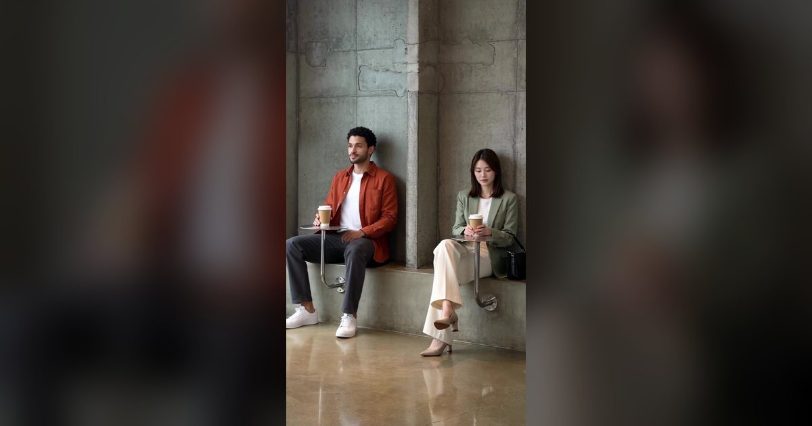

# Fancy Cafe AI 视频模板

1–2 张照片 → 19 秒一镜到底：清水混凝土的咖啡馆里，一个人端坐在小圆桌上，另一个走进来，把旁边那道台阶当椅子坐下。两个人面无表情地僵了很久，第一个人才爬下来，把杯子放回桌上。这个趋势也叫 POV: Your first time in a fancy cafe 或 fancy coffee shop trend，配乐一般说是 Steve Lacy 的《Oh Yeah?》，最早是谁发的没有定论。

> In a bare concrete cafe, one sits on the tiny table, the other sits on the ledge, and nobody admits the mistake.

## 参数

| 项 | 值 |
|---|---|
| 输入 | 1–2 张照片，每张一个成年人（只给一张时，AI 替身演另一个角色） |
| 时长 | 19 秒，一镜到底 |
| 画幅 | 9:16 竖屏 · 720p |
| 场景 | 固定的混凝土咖啡馆，不能换 |
| 服装 | 来自照片 |
| 音频 | 参考片段的原音轨，或静音 |
| 提示词 | 不需要写 |

**消耗**

| 版本 | 消耗 |
|---|---|
| 19 秒 | 900 积分 |

## 两个角色

| 角色 | 站位 | 在视频里 |
|---|---|---|
| 坐桌子的 | 右边的小圆桌上 | 一开始就坐在桌面上，最后爬下来 |
| 走进来的 | 从右侧进画面 | 把台阶当椅子坐下 |

两个人不会换位置。

## 画面顺序

1. 第一个人端着杯子，坐在小圆桌上
2. 第二个人走进来，环顾一圈
3. 他把身后的台阶当成椅子坐下
4. 两个人面无表情，长时间沉默
5. 第一个人慢慢爬下桌子，把杯子放回桌面

## 换得掉什么，换不掉什么

- **换得掉**：谁演哪个角色、一个人还是两个人、要不要声音
- **换不掉**：咖啡馆、桌子和台阶的位置、沉默的长度，以及这是一镜到底

## 上传照片前先看这几条

- 每张照片一个成年人：正脸、清晰、光线均匀，脸不被遮挡
- 衣服来自照片，所以腰部以上或全身照比大头自拍好；照片没拍到的部分会按同样风格补上
- 避开墨镜、口罩、帽檐压脸、重度滤镜和合照；也别用明星照或广告图，会被判侵权退回
- 不能是公众人物；上传时要勾选「已获得照片中人物的同意」
- 一般要等 10 分钟左右，可以关掉页面，做好的视频在 My videos 里

→ [在 aiMakeVideo 打开 Fancy Cafe 模板](https://aimakevideo.com/fancy-cafe-ai)

## 相关模板

- [Coffee Making](coffee-making.md) —— 两个人的厨房翻车，13 秒
- [Careless Whisper Car](careless-whisper-car.md) —— 车里三个人的尴尬，11 秒
- [Hop Hop Hop](hop-hop-hop.md) —— 两个人的错位搞笑，8 秒

---

[← 回到模板总览](index.md) · [积分计算器](../calculator.html) · [照片准备指南](../guide/photo-prep.md)
