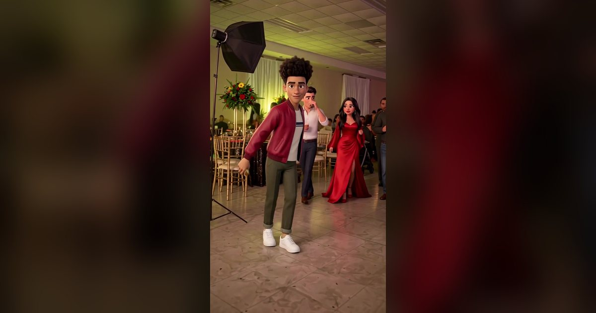

# Funk Loading AI 视频模板

1 张照片 → 8 秒：你变成 3D 动画角色，穿过派对大厅走向镜头，咬一口东西，酷酷地看一眼镜头，再转身跳着离开——大厅和在场的每个人也都是动画。走位来自 Bby Wow / Dime Dime Baby 那段派对入场，2026 年 11 月初 TikTok 上开始有人把它改成卡通角色，配 JXNDRO 的《FUNK LOADING》慢速版当片头。

> Walk through an animated party hall as a 3D character, take a bite, stare down the lens and dance away.

## 参数

| 项 | 值 |
|---|---|
| 输入 | 1 张照片，一个成年人 |
| 时长 | 8 秒 |
| 画幅 | 9:16 竖屏 · 720p |
| 场景 | 固定的派对大厅，不能换 |
| 服装 | 来自照片，一起被画成动画 |
| 音频 | 慢速版原曲，或静音 |
| 提示词 | 不需要写 |

**消耗**

| 版本 | 消耗 |
|---|---|
| 8 秒 | 600 积分 |

## 画面顺序

1. 动画化的派对大厅，你从人群里走向镜头
2. 咬一口手里的东西
3. 停下来盯着镜头
4. 转身，跳着离开画面

## 换得掉什么，换不掉什么

- **换得掉**：谁出镜、要不要声音
- **换不掉**：大厅、人群、走位和 8 秒的节奏；整段都是动画风格，不能改成真人质感

## 上传照片前先看这几条

- 这个模板会把脸画成动画，所以不要指望和照片一模一样的还原度
- 每张照片一个成年人：正脸、清晰、光线均匀，脸不被遮挡
- 衣服来自照片，所以腰部以上或全身照比大头自拍好；照片没拍到的部分会按同样风格补上
- 避开墨镜、口罩、帽檐压脸、重度滤镜和合照；也别用明星照或广告图，会被判侵权退回
- 不能是公众人物；上传时要勾选「已获得照片中人物的同意」
- 一般要等 10 分钟左右，可以关掉页面，做好的视频在 My videos 里

→ [在 aiMakeVideo 打开 Funk Loading 模板](https://aimakevideo.com/funk-loading-ai)

## 相关模板

- [Dime Dime Baby](dime-dime-baby.md) —— 同一段入场的真人版，8 秒
- [Baby Wow](baby-wow.md) —— 一张照片，人或宠物都行
- [Bicep Heart](bicep-heart.md) —— 7 秒，最便宜的单人模板之一

---

[← 回到模板总览](index.md) · [积分计算器](../calculator.html) · [照片准备指南](../guide/photo-prep.md)
