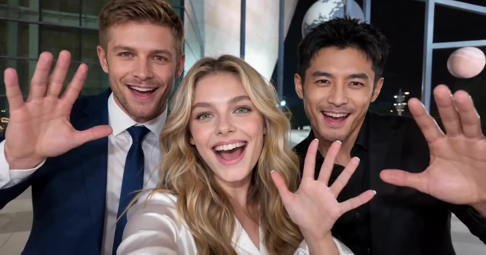

# Gangnam Style AI 视频模板

三张照片 → 15 秒或 19 秒的三人夜间合唱，每人都有自己的镜头。

> Put you and two friends into the night-time sing-along everyone is remaking: a close-up for the lead, a solo on each side, the same moves on the same beat.

## 参数

| 项 | 值 |
|---|---|
| 输入 | 3 张照片：左、中、右各一人 |
| 时长 | 15 秒（Basic Preview），或完整版 19 秒（Pro Full） |
| 画幅 | 16:9 横屏 · 720p |
| 场景 | 6 个（原版夜间广场、城市夜景天台、灯光球场、雪中城堡、日落海滩、霓虹夜市） |
| 音频 | 参考片段的原音轨，或静音（发布时自己配乐） |
| 提示词 | 不需要写 |

**消耗**

| 版本 | 消耗 |
|---|---|
| Basic Preview · 15 秒（到主唱第二个近景为止） | 900 积分 |
| Pro Full · 19 秒（完整版，结尾三人一起朝镜头挥手） | 1,350 积分 |

## 三个位置

| 位置 | 在视频里 |
|---|---|
| 中间 | 主唱，近景最多，开场就是他 |
| 左边 | 第一段独唱 |
| 右边 | 第二段独唱 |

每张照片只填一个位置，所以近景里每个人的脸都是自己的。

## 换得掉什么，换不掉什么

- **换得掉**：三个人是谁、在哪个场景、15 秒还是 19 秒、要不要声音
- **换不掉**：动作和手势、甩镜头的运镜、近景和独唱的顺序与卡点

## 上传照片前先看这几条

- 一张照片只有一个人，正脸、清晰、光线均匀
- 视频里有很大的脸部近景，所以**脸清楚比拍到全身更重要**
- 照片里穿什么，视频里就穿什么
- 避开墨镜、重度滤镜、合照和模糊截图
- 必须是成年人，且不能是公众人物；上传时要勾选「已获得照片中人物的同意」

→ [在 aiMakeVideo 打开 Gangnam Style 模板](https://aimakevideo.com/gangnam-style-ai)

## 相关模板

- [Tiny Desk](tiny-desk.md) —— 1–5 个人的办公室音乐会
- [Stereo Love Funk](stereo-love-funk.md) —— 最多 9 个人的群舞
- [Hotel Lobby](hotel-lobby.md) —— 双人 rap 对唱

---

[← 回到模板总览](index.md) · [积分计算器](../calculator.html) · [照片准备指南](../guide/photo-prep.md)
