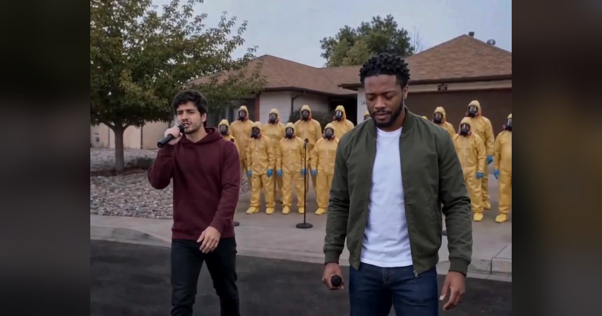

# Gangsta's Paradise AI 视频模板

1–2 张照片 → 15 或 30 秒：两个人组成说唱二人组，一个对着麦克风 rap 主歌，另一个在 30 秒版里接着唱副歌，身后站着一大群人。两个场景二选一：郊区街道，身后一排排穿黄色防护服、戴防毒面具的人站在麦克风架后面；或者牧场里的白色谷仓前，身后一排骑马的人。这个趋势也叫 Gangsta's Paradise rap duo 或 AI lip sync trend。原曲是 Coolio 和 L.V. 1995 年的《Gangsta's Paradise》，电影《危险游戏》（Dangerous Minds）的原声，拿过美国单曲榜冠军。AI 恶搞 MV 版 2026 年 11 月在 TikTok 流行。

> Two of you, one verse each, and a crowd in hazmat suits behind you.

## 参数

| 项 | 值 |
|---|---|
| 输入 | 1–2 张照片，每张一个成年人；只有一张时，另一个角色由固定的 AI 替身来演 |
| 时长 | 15 秒（主歌）/ 30 秒（主歌 + 副歌） |
| 画幅 | 4:3 · 720p |
| 场景 | 街道（防护服人群）或牧场（骑马的人），二选一 |
| 服装 | 来自照片 |
| 音频 | 原曲，或静音 |
| 提示词 | 不需要写 |

**消耗**

| 版本 | 消耗 |
|---|---|
| 15 秒 | 900 积分 |
| 30 秒 | 1,900 积分 |

## 画面顺序

1. 两个人站在人群前，第一张照片的人拿起麦克风开始 rap 主歌
2. 另一个人站在旁边跟着节奏
3. （30 秒版）主歌收尾，在原片的硬切点接上副歌
4. （30 秒版）第二个人唱副歌，人群在后面不动

## 换得掉什么，换不掉什么

- **换得掉**：谁 rap、谁唱副歌、街道还是牧场、15 秒还是 30 秒、有声还是静音
- **换不掉**：身后的人群、麦克风架、机位和剪辑节奏

## 上传照片前先看这几条

- 两个人都要开口，头发别挡住嘴
- 两个场景都有近景和全景，正脸清楚、能拍到腰部以下的照片最好
- 帽子和眼镜只有照片里有才会出现
- 第一张照片是 rap 主歌的人，顺序别放反
- 避开墨镜、口罩、重度滤镜、合照，以及明星照或剧照，会被拒，积分退回
- 照片的背景不会进视频，不用特意找干净的背景
- 一般要等几分钟，可以关掉页面，做好的视频在 My videos 里

→ [在 aiMakeVideo 打开 Gangsta's Paradise 模板](https://aimakevideo.com/gangstas-paradise-ai)

## 相关模板

- [Hotel Lobby](hotel-lobby.md) —— 两个人在橙色电话亭里对唱
- [Migos](migos.md) —— 双人 rap，自带原创歌
- [58th Floor](58th-floor.md) —— 两个人对着一支吊麦轮唱

---

[← 回到模板总览](index.md) · [积分计算器](../calculator.html) · [照片准备指南](../guide/photo-prep.md)
