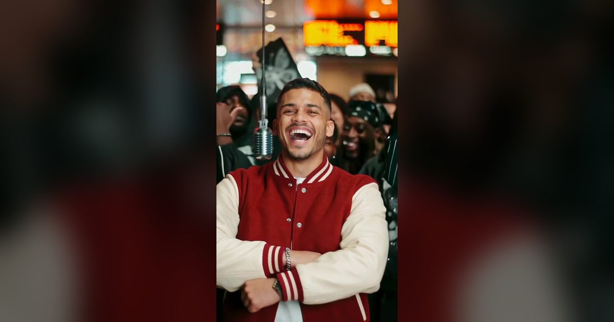

# BigXthaPlug Give It All AI 视频模板

1 张照片 → 15 秒：一家挤满人的电影院大堂，一支老式镀铬麦克风吊在线上，你站在它前面 rap，人群贴在你身后。三个镜头按原片的切点来：先是正面，你看一眼手腕、抱臂大笑；再切到侧面，你双手扶向麦克风，镜头绕到你脸前；最后是麦克风下面的一个广角。这个趋势也叫 Give It All to Me AI、hanging mic AI 或 BigX From The Block。原型是 BigXthaPlug 专辑《Better Over Time》（2026 年 10 月 30 日发行）里《Give It All》的 From The Block 现场，在达拉斯一家电影院大堂拍的。AI 版 2026 年 11 月在 TikTok 流行。

> One photo, one hanging microphone, a whole lobby at your back.

## 参数

| 项 | 值 |
|---|---|
| 输入 | 1 张照片，一个成年人 |
| 时长 | 15 秒 |
| 画幅 | 9:16 竖屏 · 480p / 720p |
| 场景 | 固定的电影院大堂、人群和吊麦，不能换 |
| 服装 | 来自照片 |
| 音频 | 原曲，或静音 |
| 提示词 | 不需要写 |

**消耗**

| 版本 | 消耗 |
|---|---|
| 480p | 600 积分 |
| 720p | 1,050 积分 |

有声、静音同价。

## 画面顺序

1. 正面：你凑近麦克风笑，然后低头看手腕
2. 你大笑、抱起手臂，朝镜头甩一下手
3. 切到侧面：双手举到麦克风前，镜头绕到你脸前
4. 脸部近景：闭眼、摊开手掌，一只手伸向镜头
5. 双手手腕在胸前交叉
6. 切到广角：你在麦克风下 rap，整片人群在身后

## 换得掉什么，换不掉什么

- **换得掉**：谁站在麦克风前、穿什么、有声还是静音、480p 还是 720p
- **换不掉**：大堂、身后的人群、吊着的麦克风、三个镜头的切点。只能一个人，不能加朋友，也不能换宠物

## 上传照片前先看这几条

- 中段是脸部近景，所以脸清晰最要紧：正脸、光线均匀、不被遮挡
- 衣服来自照片，腰部以上的照片能把衣服带进视频
- 帽子、墨镜、项链跟着照片走，但不保证每次都留住；手腕上也可能多出一块表或手链，示例里就有
- 原片是横屏，竖版是从中间裁出来的，两侧的人群会少一些
- 避开墨镜、口罩、重度滤镜和合照；也别用明星照或广告图，会被拒，积分退回
- 不能是公众人物；上传时要勾选「已获得照片中人物的同意」
- 一般要等几分钟，可以关掉页面，做好的视频在 My videos 里

→ [在 aiMakeVideo 打开 Give It All 模板](https://aimakevideo.com/bigxthaplug-give-it-all-ai)

## 相关模板

- [Stormzy Shut Up](stormzy-shut-up.md) —— 一群朋友挤在身后，对着手持镜头唱副歌
- [58th Floor](58th-floor.md) —— 也是一支吊麦，两个人轮流唱
- [Schooling Seniors](schooling-seniors.md) —— 停车场夜景，直视镜头 rap

---

[← 回到模板总览](index.md) · [积分计算器](../calculator.html) · [照片准备指南](../guide/photo-prep.md)
