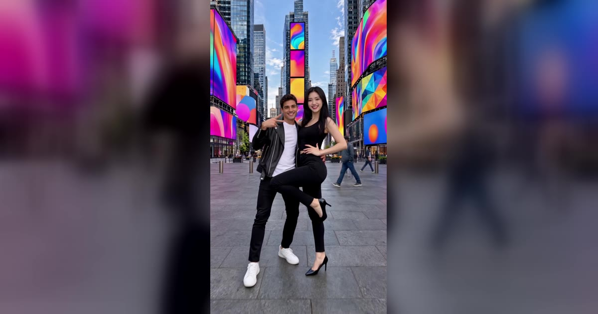

# Grease Dance AI 视频模板

1–2 张照片 → 15 秒或 23 秒的复古摇滚双人舞，一个全景镜头从头拍到脚。

> You and your partner dance the flirty couple routine head to toe in one wide shot: side by side, a high kick, two side swaps and, in the full version, the final pose.

## 参数

| 项 | 值 |
|---|---|
| 输入 | 1–2 张照片（只给一张时，AI 舞伴跳另一个角色） |
| 时长 | 15 秒，或完整版 23 秒 |
| 画幅 | 9:16 竖屏 · 720p |
| 场景 | 6 个预设（城市广场、复古餐厅、校园舞会、海滨木栈道、夜晚游乐场、夜晚天台），或上传自己的空场景照片 |
| 造型 | 原版造型（皮夹克 + 白 T；黑色紧身装 + 高跟鞋），或保留各自照片里的衣服 |
| 音频 | 参考片段的原音轨，或静音（发布时自己配乐） |
| 提示词 | 不需要写 |

**消耗**

| 时长 | 消耗 |
|---|---|
| 15 秒（两次换位，停在舞蹈中段） | 800 积分 |
| 完整 23 秒（整套舞，停在结尾定格） | 1,200 积分 |

## 两个角色

- **左边起步**：皮夹克角色
- **右边起步**：黑色紧身装角色，先踢腿，结尾靠向舞伴
- 两人跳舞时会交叉换位两次，**每个人的脸全程不会换**；照片放在哪个位置，就跳哪个角色，「Swap」按钮可以一键对调
- 谁跳哪个角色都可以，不限性别

## 换得掉什么，换不掉什么

- **换得掉**：谁来跳、在哪跳、15 秒还是 23 秒、原版造型还是自己的衣服、要不要声音
- **换不掉**：舞步（并排、高踢腿、两次换位、结尾定格）、一个固定的全景镜头、卡点节奏

## 上传照片前先看这几条

- 视频是全景，人在画面里比较小，所以**脸清楚比什么都重要**：正脸、清晰、光线均匀、不被遮挡
- 选「自己的衣服」时，照片要拍到腰部以上或全身
- 用自己的场景时，上传一张**平视、视野开阔、前面有空地**的空场景照片
- 避开墨镜、口罩、重度滤镜和合照
- 必须是成年人，且不能是公众人物；上传时要勾选「已获得照片中人物的同意」

→ [在 aiMakeVideo 打开 Grease Dance 模板](https://aimakevideo.com/grease-dance-ai)

## 相关模板

- [Raindance](raindance.md) —— 独舞或双人，8 秒
- [Zombie](zombie.md) —— 两张照片的双人故事
- [Thriller Dance](thriller-dance.md) —— 一张照片领舞丧尸群

---

[← 回到模板总览](index.md) · [积分计算器](../calculator.html) · [照片准备指南](../guide/photo-prep.md)
