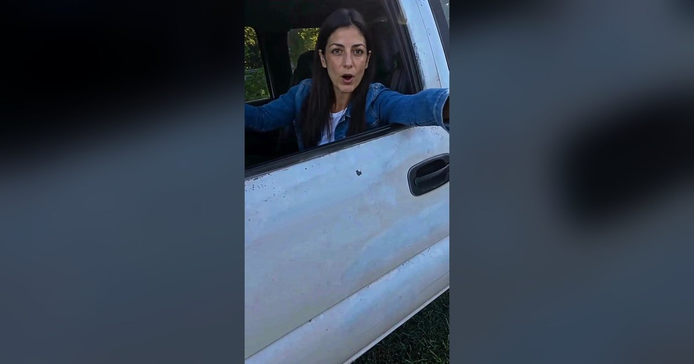

# Hit the Road Dude AI 视频模板

1 张照片（人或宠物）→ 13 秒：你坐在白色皮卡的驾驶位上，冲着窗外钓鱼的人说「State? This? Hit the road, dude. This is private property.」这个梗也叫 State Property meme、Private Property meme 或 Lock 'Em Up，翻拍自 @bird28thegr8 2025 年 8 月发在 TikTok 的手机片段。

> From the driver's seat of a white pickup, tell the fisherman this is private property.

## 参数

| 项 | 值 |
|---|---|
| 输入 | 1 张照片：一个成年人，或一只宠物 |
| 时长 | 13 秒 |
| 画幅 | 9:16 竖屏 · 720p |
| 场景 | 固定的白色皮卡驾驶位，不能换 |
| 服装 | 来自照片 |
| 音频 | 原片的人声、AI 配音，或静音 |
| 提示词 | 不需要写 |

**消耗**

| 版本 | 消耗 |
|---|---|
| 13 秒 | 900 积分（三种音频同价） |

## 画面顺序

1. 镜头在车内，你坐在驾驶位上
2. 转头看向窗外
3. 说出那几句台词
4. 最后一句落下，表情定住

## 换得掉什么，换不掉什么

- **换得掉**：谁出镜（人或宠物）、三种音频里选一种
- **换不掉**：皮卡、机位、台词内容和说话的节奏

## 上传照片前先看这几条

- 宠物照也能用，嘴型不会对上台词，但表情和姿势会跟着走
- 人物照：一个成年人，正脸、清晰、光线均匀；宠物照：整只入镜，脸朝镜头
- 衣服来自照片，所以腰部以上或全身照比大头自拍好；照片没拍到的部分会按同样风格补上
- 避开墨镜、口罩、帽檐压脸、重度滤镜和合照；也别用明星照或广告图，会被判侵权退回
- 不能是公众人物；上传时要勾选「已获得照片中人物的同意」
- 一般要等 10 分钟左右，可以关掉页面，做好的视频在 My videos 里

→ [在 aiMakeVideo 打开 Hit the Road Dude 模板](https://aimakevideo.com/hit-the-road-dude-ai)

## 相关模板

- [Single Ladies Dog Dance](single-ladies-dog.md) —— 宠物或人，15 秒
- [Baby Wow](baby-wow.md) —— 宠物或人，8 秒
- [Monkey Eating Apple](monkey-eating-apple.md) —— 一个人和一只猕猴抢苹果

---

[← 回到模板总览](index.md) · [积分计算器](../calculator.html) · [照片准备指南](../guide/photo-prep.md)
