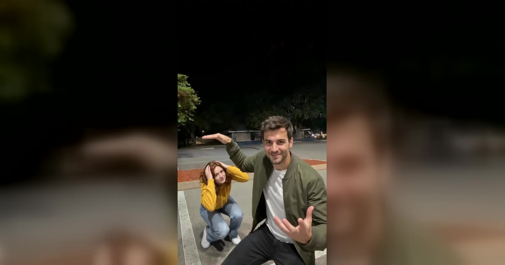

# Hop Hop Hop AI 视频模板

1–2 张照片 → 8 秒夜间停车场错位短片：近处的人抬起手掌，把远处的人「按」进地里，一个硬切后两人互换。这个趋势也叫 Gabi trend 或 Her Boyfriend dance。

> Put two people into the night parking lot clip everyone is remaking. One grins at the camera and presses the other down from far away with a flat hand. A hard cut, and they swap.

## 参数

| 项 | 值 |
|---|---|
| 输入 | 1–2 张照片，每张一个成年人（只给一张时，你一人分饰两角，像双胞胎，衣服也相同） |
| 时长 | 8 秒 |
| 画幅 | 9:16 竖屏 · 720p |
| 场景 | 固定的夜间停车场，不能换 |
| 服装 | 来自照片 |
| 音频 | 参考片段的原音轨，或静音（发布时自己配乐） |
| 提示词 | 不需要写 |

**消耗**

| 分辨率 | 消耗 |
|---|---|
| 720p | 600 积分（一张还是两张照片、有没有声音都同价） |

## 两个位置

| 照片 | 开场位置 | 什么时候被「按」 |
|---|---|---|
| 第一张 | 靠近镜头 | 硬切之后 |
| 第二张 | 远处 | 硬切之前，先被按 |

每个人大约有一半时间在近处，所以两张照片的脸都要清楚。

## 每一秒发生什么

| 时间 | 画面 |
|---|---|
| 0–1 秒 | 近处的人对着镜头挥手 |
| 1–2.6 秒 | 指向后面，远处的人踩着节拍蹦跳 |
| 2.6–4.4 秒 | 手掌举到远处那人的头顶上方，对方一步步蹲下去 |
| 4.4 秒 | 硬切，两人互换位置 |
| 4.4–6.2 秒 | 新的近处的人指向后面，另一个人上下蹦跳 |
| 6.2–8 秒 | 双臂举起，远处的人蹲到很低，一直不起来 |

## 这个效果为什么成立

两个人其实没有碰到。一个离镜头很近，一个离得很远，手掌正好落在远处那人的头顶上方，看起来就像把人按进地里。所以站位、机位和手的位置都不能动，这也是模板把它们固定下来的原因。

## 换得掉什么，换不掉什么

- **换得掉**：谁出镜（脸、发型和衣服都来自照片）、一个人还是两个人、要不要声音
- **换不掉**：停车场、机位、动作、4.4 秒左右的那个硬切

目前不支持宠物，只接受成年人的照片。

## 上传照片前先看这几条

- 每张照片一个成年人：正脸、清晰、光线均匀、脸不被遮挡
- 衣服来自照片，所以腰部以上或全身照比自拍好；照片没拍到的部分，会按同样的日常风格补上
- 避开墨镜、口罩、重度滤镜和合照
- 不能是公众人物；上传时要勾选「已获得照片中人物的同意」
- 一般要等 10 分钟左右，可以关掉页面，做好的视频在 My videos 里

→ [在 aiMakeVideo 打开 Hop Hop Hop 模板](https://aimakevideo.com/hop-hop-hop-ai)

## 相关模板

- [Coffee Making](coffee-making.md) —— 同样是两个人的搞笑短片，13 秒
- [Toc Toc](toc-toc.md) —— 一张照片的 10 秒单人舞
- [Raindance](raindance.md) —— 独舞或双人，8 秒

---

[← 回到模板总览](index.md) · [积分计算器](../calculator.html) · [照片准备指南](../guide/photo-prep.md)
