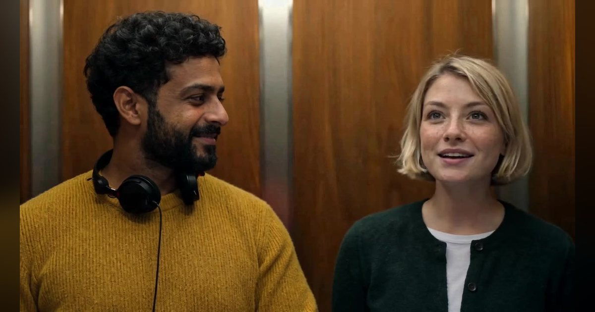

# I Love The Smiths AI 视频模板

1–2 张照片 → 15 秒：木饰面电梯里，一个人戴着耳机，另一个凑过来说「我也喜欢 The Smiths」，说了两遍对方才听见，然后轻声哼了一句。这是在重演《和莎莫的 500 天》（2009，导演 Marc Webb）里 Tom 和 Summer 第一次搭话的那场戏，耳机里放的是 The Smiths 1986 年的《There Is a Light That Never Goes Out》。AI 双人版 2026 年 11 月初在 TikTok 流行，这个趋势也叫 "I said I love the Smiths"。

> In a wood-panelled elevator, one of you says they love the band in the other's headphones, twice.

## 参数

| 项 | 值 |
|---|---|
| 输入 | 1–2 张照片，每张一个成年人（只给一张时，固定的 AI 演员演另一个角色） |
| 时长 | 15 秒 |
| 画幅 | 16:9 横屏 · 720p |
| 场景 | 固定的电梯，不能换 |
| 服装 | 来自照片 |
| 音频 | 原片的对白，或静音 |
| 提示词 | 不需要写 |

**消耗**

| 版本 | 消耗 |
|---|---|
| 15 秒 | 900 积分 |

## 两个角色

| 角色 | 站位 | 在视频里 |
|---|---|---|
| 戴耳机的 | 画面左边 | 低头听歌，被搭话的那位 |
| 说话的 | 画面右边 | 说台词，最后轻声哼一句 |

两个人不会换边。只填一个角色时，另一边是固定的 AI 演员。

## 画面顺序

1. 电梯里两个人并排站着，左边的人戴着耳机
2. 右边的人凑过去说了一句
3. 对方没听清，他又说了一遍
4. 右边的人轻声哼出那句歌词
5. 电梯到了，画面结束

## 换得掉什么，换不掉什么

- **换得掉**：谁演哪一边、一个人还是两个人、要不要声音
- **换不掉**：电梯、台词、说两遍的节奏和镜头角度

## 上传照片前先看这几条

- 嘴型是跟着对白走的，正脸清晰的照片效果最好
- 每张照片一个成年人：正脸、清晰、光线均匀，脸不被遮挡
- 衣服来自照片，所以腰部以上或全身照比大头自拍好；照片没拍到的部分会按同样风格补上
- 避开墨镜、口罩、帽檐压脸、重度滤镜和合照；也别用明星照或广告图，会被判侵权退回
- 不能是公众人物；上传时要勾选「已获得照片中人物的同意」
- 一般要等 10 分钟左右，可以关掉页面，做好的视频在 My videos 里

→ [在 aiMakeVideo 打开 I Love The Smiths 模板](https://aimakevideo.com/i-love-the-smiths-ai)

## 相关模板

- [Schooling Seniors](schooling-seniors.md) —— 一个人对着镜头说唱，9 秒
- [58th Floor](58th-floor.md) —— 两个人对着同一支麦轮唱
- [Zombie](zombie.md) —— 两张照片的双人故事

---

[← 回到模板总览](index.md) · [积分计算器](../calculator.html) · [照片准备指南](../guide/photo-prep.md)
