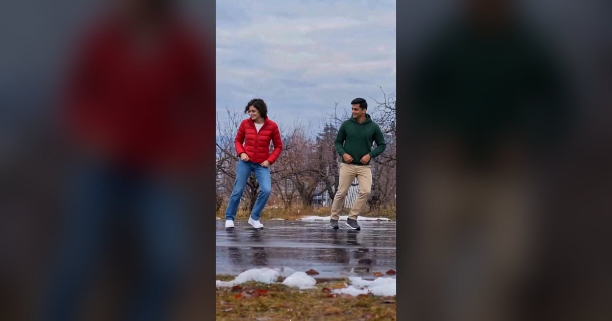

# Ice Ice Baby AI 视频模板

1–2 张照片 → 11 秒：冬天的室外篮球场，地面是湿的，背后是光秃的果树和残雪，两个人跳同一套动作：抬膝、快速交叉步、下蹲、踢腿，最后双手举起来。低机位慢慢推近。配曲是 Vanilla Ice 1990 年的《Ice Ice Baby》，第一首登上 Billboard Hot 100 冠军的嘻哈单曲。

> Two people dance the same routine in step on a wet winter basketball court.

## 参数

| 项 | 值 |
|---|---|
| 输入 | 1–2 张照片，每张一个成年人（只给一张时，固定的 AI 舞伴跳另一边） |
| 时长 | 11 秒 |
| 画幅 | 9:16 竖屏 · 720p |
| 场景 | 固定的冬日篮球场，不能换 |
| 服装 | 来自照片 |
| 音频 | 原曲，或静音 |
| 提示词 | 不需要写 |

**消耗**

| 版本 | 消耗 |
|---|---|
| 11 秒 | 800 积分 |

## 两个角色

| 角色 | 站位 | 在视频里 |
|---|---|---|
| 左边 | 画面左侧 | 和右边同步跳，从头到尾不换边 |
| 右边 | 画面右侧 | 同上 |

只填一个角色时，另一边是固定的 AI 舞伴。

## 画面顺序

1. 两个人站定，镜头在低位
2. 抬膝，踩着拍子
3. 快速交叉步
4. 低蹲，接踢腿
5. 双手举起来，镜头推到最近

## 换得掉什么，换不掉什么

- **换得掉**：谁站哪边、一个人还是两个人、要不要声音
- **换不掉**：球场、冬天的环境、舞步顺序和推镜的节奏

## 上传照片前先看这几条

- 这是全身动作的模板，全身照或至少腰部以上的照片比大头照好
- 每张照片一个成年人：正脸、清晰、光线均匀，脸不被遮挡
- 衣服来自照片，所以腰部以上或全身照比大头自拍好；照片没拍到的部分会按同样风格补上
- 避开墨镜、口罩、帽檐压脸、重度滤镜和合照；也别用明星照或广告图，会被判侵权退回
- 不能是公众人物；上传时要勾选「已获得照片中人物的同意」
- 一般要等 10 分钟左右，可以关掉页面，做好的视频在 My videos 里

→ [在 aiMakeVideo 打开 Ice Ice Baby 模板](https://aimakevideo.com/ice-ice-baby-dance-ai)

## 相关模板

- [Grease Dance](grease-dance.md) —— 两个人的复古双人舞
- [Toc Toc](toc-toc.md) —— 一张照片的 10 秒单人舞
- [24K Magic](24k-magic.md) —— 游轮甲板上的群舞

---

[← 回到模板总览](index.md) · [积分计算器](../calculator.html) · [照片准备指南](../guide/photo-prep.md)
