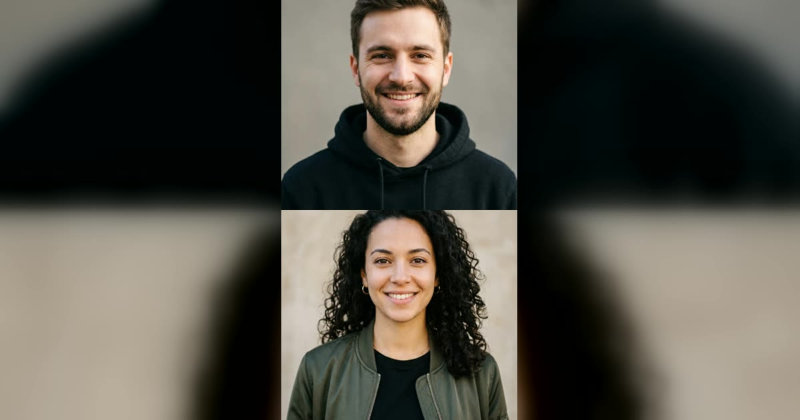

# Migos AI 双人 Rap 模板

两张照片 → 10 秒双人 rap，一问一答。

> Two friends, one booth, back-and-forth bars — with an original song of your own.

## 参数

| 项 | 值 |
|---|---|
| 输入 | 2 张照片（每人一张正脸照，或一张双人合照） |
| 时长 | 10 秒 |
| 画幅 | 9:16 竖屏 |
| 音频 | 原声 |
| 提示词 | 不需要写 |

**消耗**

| 分辨率 | 消耗 |
|---|---|
| 480p | 310 积分 |
| 720p | 682 积分 |

**可选风格 / 场景**：Orange booth、Luxury lobby、Studio booth、Street cypher、Golden hour pier

## 换得掉什么，换不掉什么

- **换得掉**：人物、舞台、歌的风格、唱什么（可选填）
- **换不掉**：对唱结构

## 上传照片前先看这几条

- 每张照片里只能有一个人（双人模板也可以只给一张双人合照）
- 正脸、光线均匀、脸完全不被遮挡
- 必须是成年人，且不能是公众人物
- 上传时要勾选「已获得照片中人物的同意」——这条是硬性要求

→ [在 aiMakeVideo 打开 Migos 模板](https://aimakevideo.com/migos-ai)

---

[← 回到模板总览](index.md) · [积分怎么算](../credits.md)
