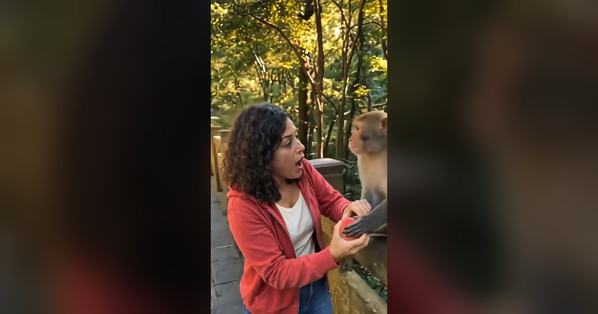

# Monkey Eating Apple AI 视频模板

1 张照片 → 9 秒一镜到底：你在阳光下的林间步道上咬苹果，一只猕猴冲过来抢，拍你的头、揪你的头发，松手之后又伸长手臂把苹果拿走了，最后定格在你震惊的脸上。这个趋势也叫 monkey takes apple、monkey snatches apple 或 the macaque apple trend。我们找到的最早一条是 @user7453115952617 2026 年 11 月 1 日发在 TikTok 的视频，标注为 AI 生成并关联了一个 CapCut 模板。

> Bite an apple on a forest walkway, lose a fight with a macaque, and end on your shocked face.

## 参数

| 项 | 值 |
|---|---|
| 输入 | 1 张照片，一个成年人 |
| 时长 | 9 秒，一镜到底 |
| 画幅 | 9:16 竖屏 · 720p |
| 场景 | 固定的林间步道，不能换 |
| 服装 | 来自照片 |
| 音频 | 原片的声音，或静音 |
| 提示词 | 不需要写 |

**消耗**

| 版本 | 消耗 |
|---|---|
| 9 秒 | 650 积分 |

## 画面顺序

1. 你在步道上咬了一口苹果
2. 猕猴冲上来抢，拍你的头
3. 它揪住你的头发
4. 松手，看起来像是放弃了
5. 长手臂一伸，苹果还是被拿走了
6. 镜头推到你震惊的脸上

## 换得掉什么，换不掉什么

- **换得掉**：谁出镜、要不要声音
- **换不掉**：步道、猕猴的动作顺序、抢苹果的结局和结尾的近景

## 上传照片前先看这几条

- 只做人物版本，宠物照片目前不适用这个模板
- 每张照片一个成年人：正脸、清晰、光线均匀，脸不被遮挡
- 衣服来自照片，所以腰部以上或全身照比大头自拍好；照片没拍到的部分会按同样风格补上
- 避开墨镜、口罩、帽檐压脸、重度滤镜和合照；也别用明星照或广告图，会被判侵权退回
- 不能是公众人物；上传时要勾选「已获得照片中人物的同意」
- 一般要等 10 分钟左右，可以关掉页面，做好的视频在 My videos 里

→ [在 aiMakeVideo 打开 Monkey Eating Apple 模板](https://aimakevideo.com/monkey-eating-apple-ai)

## 相关模板

- [Hit the Road Dude](hit-the-road-dude.md) —— 皮卡里的 13 秒小品
- [Crazy Frog](crazy-frog.md) —— 一张照片的 15 秒搞笑
- [Coffee Making](coffee-making.md) —— 两个人的厨房翻车

---

[← 回到模板总览](index.md) · [积分计算器](../calculator.html) · [照片准备指南](../guide/photo-prep.md)
