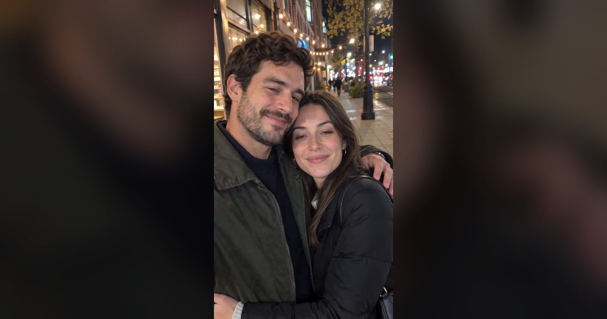

# My Moon My Man AI 视频模板

这个趋势有两种发法，同一个页面都能做：

- **情侣视频**：1 张两个人的合照 → 10 秒竖屏。一个人对着镜头笑，转身被另一个人拉进怀里，两个人轻轻晃，最后一起回头看镜头。没有固定场景，地点和光线都来自你的照片
- **耶稣油画**：1 张你自己的照片 → 一张竖版油画。你跪下去摘一朵小花，耶稣站在你身边，背后藏着一大束花。大家把它放在自己的照片之后当第二张图，配文常是「my moon, my Father」

配乐是 Feist 2007 年专辑《The Reminder》里的《My Moon My Man》，用的是 FINNEAS 在 2026 年加拿大词曲作者名人堂上唱的慢版。情侣们从 2026 年 11 月开始在 TikTok 上发，也叫 soft launch trend。

> A smile at the lens, a pull into a hug, a look back together.

## 参数

| 项 | 情侣视频 | 耶稣油画 |
|---|---|---|
| 输入 | 1 张两人合照；没有合照就各传 1 张单人照 | 1 张你自己的照片 |
| 输出 | 10 秒视频，9:16 竖屏 · 720p | 竖版油画，Standard / HD |
| 场景 | 来自你的照片 | 固定的油画构图 |
| 服装 | 来自照片 | 来自照片 |
| 音频 | 趋势音的前 10 秒，或静音（发的时候在 App 里选音乐） | 无 |
| 提示词 | 不需要写 | 不需要写 |

**消耗**

| 版本 | 消耗 |
|---|---|
| 情侣视频 10 秒 | 395 积分 |
| 耶稣油画 Standard | 9 积分 |
| 耶稣油画 HD | 15 积分 |

## 画面顺序（情侣视频）

1. 一个人对着镜头笑
2. 转身，被另一个人拉进怀里
3. 两个人抱着轻轻晃
4. 一起回头看镜头

## 换得掉什么，换不掉什么

- **换得掉**：谁出镜、地点、光线、衣服，全部来自照片；有声还是静音
- **换不掉**：动作的顺序和节奏

## 上传照片前先看这几条

- 合照：只有你们两个人，站着或坐着靠近一点，两张脸都清楚地朝向镜头，拍到腰部以上；竖拍最好
- 光线好，脸更像本人
- 油画只要一张你自己的清晰照片，大约一分钟出图
- 静音版发 TikTok 时在 App 里选 My Moon My Man 的声音，视频会归到这个音乐下面
- 视频一般要等几分钟，可以关掉页面，做好的视频在 My videos 里

→ [在 aiMakeVideo 打开 My Moon My Man 模板](https://aimakevideo.com/my-moon-my-man-ai)

## 相关模板

- [Bicep Heart](bicep-heart.md) —— 情侣版两个人用手臂比心
- [Christmas Dance](christmas-dance.md) —— 两个人的圣诞睡衣舞
- [Grease Dance](grease-dance.md) —— 双人舞的经典款

---

[← 回到模板总览](index.md) · [积分计算器](../calculator.html) · [照片准备指南](../guide/photo-prep.md)
