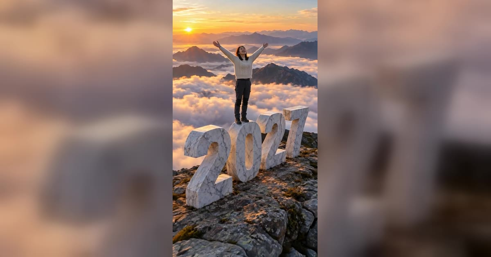

# New Year AI 视频模板

一个页面三种新年视频：站上巨大的 2027 大理石数字、午夜倒数放烟花、拜年送红包。一张照片就能做，加第二张就是两个人一起，每条都是 10 秒。

> Stand on a giant 2027 above the clouds, toast at midnight under fireworks, or send Lunar New Year wishes. One photo, no filming.

## 三种视频

| 项 | Hello 2027 | Midnight Countdown 午夜倒数 | Lunar New Year 农历新年 |
|---|---|---|---|
| 内容 | 爬上巨大的 2027 数字，站起来张开双臂，无人机后拉露出云海和整个 2027 | 手指倒数三、二、一，第一朵烟花在身后炸开，欢呼、举杯，最后飞吻 | 抱拳作揖、鞠躬，双手递出红包，灯笼上空放烟花，最后挥手 |
| 场景（各 5 个） | 日出山顶、海边悬崖、雪峰、城市天台、沙漠沙丘 | 天台派对、海港步道、城市广场、山间木屋、海滩派对 | 灯笼街、庭院、河畔、雪中花园、庙会 |
| 服装 | 照片里自己的衣服 | 派对装，或照片里自己的衣服 | 喜庆红色丝绸装，或照片里自己的衣服 |
| 音频 | 风声加弦乐和铜管，随后拉镜头渐强，或静音 | 三声提示音加一声烟花巨响，改编自公有领域的 Auld Lang Syne，或静音 | 鼓、锣、鞭炮加原创旋律，或静音 |

三种视频共用的参数：

| 项 | 值 |
|---|---|
| 输入 | 1–2 张照片，每张一个成年人 |
| 时长 | 10 秒 |
| 画幅 | 9:16 竖屏 · 720p |
| 提示词 | 不需要写 |

**消耗**

| 分辨率 | 消耗 |
|---|---|
| 720p | 600 积分（三种视频、任何场景都同价，一个人和两个人也同价） |

## 每一秒发生什么

每次生成都按同样的时间线走。

**Hello 2027**

| 时间 | 画面 |
|---|---|
| 0–2.5 秒 | 爬上数字 0 的顶部 |
| 2.5–4.5 秒 | 站起来，找到平衡，笑 |
| 4.5–6.5 秒 | 张开双臂，风吹头发 |
| 6.5–10 秒 | 无人机后拉升高，露出云海和整个 2027 |

**Midnight Countdown**

| 时间 | 画面 |
|---|---|
| 0–3.5 秒 | 天还黑着，用手指倒数三、二、一 |
| 3.5 秒 | 第一朵金色烟花在身后炸开 |
| 4–6 秒 | 欢呼，向镜头举杯（两个人时碰杯） |
| 6–10 秒 | 金色彩纸、更多烟花，飞吻或拥抱，笑到结尾 |

**Lunar New Year**

| 时间 | 画面 |
|---|---|
| 0–2 秒 | 抱拳作揖，鞠躬两次 |
| 2–4.5 秒 | 双手递出一个素色红包 |
| 4.5–7 秒 | 红色和金色的烟花在灯笼上空炸开 |
| 7–10 秒 | 双手挥动，笑到结尾 |

## 换得掉什么，换不掉什么

- **换得掉**：谁出镜、一个人还是两个人、在 5 个场景里选哪个、穿什么（倒数和拜年可选）、要不要声音
- **换不掉**：每种视频的动作和时间线、镜头运动、年份（固定是 2027）

几个容易问到的细节：

- **数字会不会写错**：2027 是先画进第一帧再生成视频的，视频只需要在镜头移动时保持住，所以镜头移动时年份不会变。倒数视频里的年份气球也是这样做的
- **拜年视频里没有任何文字**：红包是素色的，灯笼上也不写字，这样就不会出现乱码的汉字
- **农历新年是哪天**：2027 年 2 月 6 日（周六），羊年开始；元宵节是 2 月 20 日

## 上传照片前先看这几条

- 每张照片一个成年人：正脸、清晰、光线好，最好拍到腰部以上
- 避开墨镜、遮住头发的帽子和重度滤镜，这些会让脸和发型更难保留
- 只拍到腰部时，裤子和鞋由模型补出来，不一定和你本人穿的一样；Hello 2027 会拍到全身，介意的话用全身照
- 两个人要传两张照片，不要传一张合照：第一张站左边（Hello 2027 里站在数字 0 上），第二张站右边
- 不能传孩子的照片，也不能是公众人物；上传时要勾选「已获得照片中人物的同意」
- 想在跨年夜零点发的话，最晚 12 月 31 日白天做好：平时几分钟出片，当晚可能会慢一些

→ [在 aiMakeVideo 打开 New Year 模板](https://aimakevideo.com/new-year-ai)

## 相关模板

- [Christmas](christmas.md) —— 跳舞的圣诞精灵，或家庭监控「拍到」圣诞老人
- [Grease Dance](grease-dance.md) —— 同样可以两个人一起，也能选场景
- [WYW My Sweetie](wyw-my-sweetie.md) —— 一张照片的单人舞，可选场景和造型

---

[← 回到模板总览](index.md) · [积分计算器](../calculator.html) · [照片准备指南](../guide/photo-prep.md)
