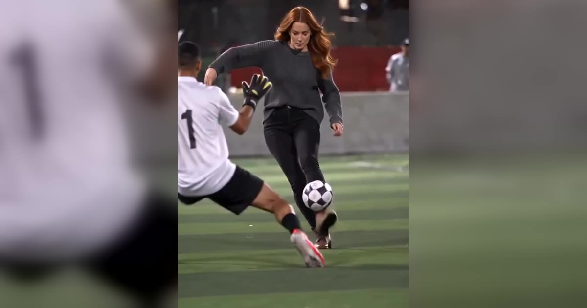

# Ozil Goal AI 视频模板

一张照片 → 15 秒足球进球镜头。

> One photo puts you on the ball: you chip the keeper, skip past two defenders and roll it into the empty net.

## 参数

| 项 | 值 |
|---|---|
| 输入 | 1 张照片（最好从头到脚，鞋也在画面里） |
| 时长 | 15 秒 |
| 画幅 | 9:16 竖屏 · 720p |
| 音频 | 可保留原声，也可静音 |
| 提示词 | 不需要写 |

**消耗**

| 分辨率 | 消耗 |
|---|---|
| 720p | 800 积分 |

**可选风格 / 场景**：页面提供示例照片，可以先拿它试

## 换得掉什么，换不掉什么

- **换得掉**：射门的人（脸、服装、鞋都取自照片）
- **换不掉**：动作、镜头、时机

## 上传照片前先看这几条

- 每张照片里只能有一个人（双人模板也可以只给一张双人合照）
- 正脸、光线均匀、脸完全不被遮挡
- 必须是成年人，且不能是公众人物
- 上传时要勾选「已获得照片中人物的同意」——这条是硬性要求

→ [在 aiMakeVideo 打开 Ozil Goal 模板](https://aimakevideo.com/ozil-goal-ai)

---

[← 回到模板总览](index.md) · [积分怎么算](../credits.md)
