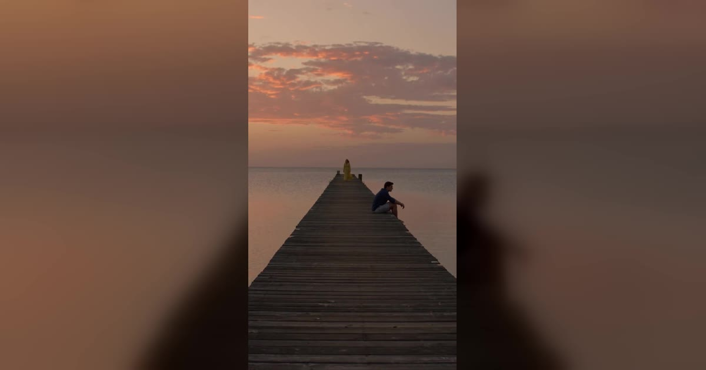

# Raindance AI 视频模板

一到两张照片 → 8 秒 Raindance 舞蹈（独舞或双人）。

> Pick a solo or duet scene for the Raindance trend, then choose Face & hair or Full look.

## 参数

| 项 | 值 |
|---|---|
| 输入 | 1 或 2 张照片 |
| 时长 | 8 秒 |
| 画幅 | 9:16 竖屏 |
| 音频 | 静音，发布时加趋势音乐 |
| 提示词 | 不需要写 |

**消耗**

| 分辨率 | 消耗 |
|---|---|
| 480p | 328 积分 |
| 720p | 626 积分 |

**可选风格 / 场景**：Two on the pier（双人）、Golden hour（独舞）、Blue-hour rain（独舞）

## 换得掉什么，换不掉什么

- **换得掉**：脸和发型，或整个人的外形
- **换不掉**：舞蹈动作、镜头

## 上传照片前先看这几条

- 每张照片里只能有一个人（双人模板也可以只给一张双人合照）
- 正脸、光线均匀、脸完全不被遮挡
- 必须是成年人，且不能是公众人物
- 上传时要勾选「已获得照片中人物的同意」——这条是硬性要求

→ [在 aiMakeVideo 打开 Raindance 模板](https://aimakevideo.com/raindance-ai)

---

[← 回到模板总览](index.md) · [积分怎么算](../credits.md)
