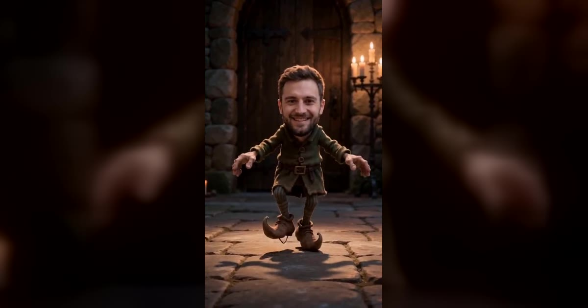

# Rumpelstiltskin AI 视频模板

一张照片 → 8 秒踮脚舞。

> Put your face, or your whole look, on the tiptoe dance and download an 8-second vertical MP4 with no watermark.

## 参数

| 项 | 值 |
|---|---|
| 输入 | 1 张照片 |
| 时长 | 8 秒 |
| 画幅 | 9:16 竖屏 |
| 音频 | 静音 |
| 提示词 | 不需要写 |

**消耗**

| 分辨率 | 消耗 |
|---|---|
| 480p | 328 积分 |
| 720p | 626 积分 |

**可选风格 / 场景**：Candle-lit stone room（烛光石室）、Tavern table（酒馆桌面）

## 换得掉什么，换不掉什么

- **换得掉**：脸和发型，或整个人的外形
- **换不掉**：舞蹈动作、镜头

## 上传照片前先看这几条

- 每张照片里只能有一个人（双人模板也可以只给一张双人合照）
- 正脸、光线均匀、脸完全不被遮挡
- 必须是成年人，且不能是公众人物
- 上传时要勾选「已获得照片中人物的同意」——这条是硬性要求

→ [在 aiMakeVideo 打开 Rumpelstiltskin 模板](https://aimakevideo.com/rumpelstiltskin-ai)

## 相关模板

- [Raindance](raindance.md) —— 8 秒独舞或双人舞
- [Stereo Love Funk](stereo-love-funk.md) —— 群舞版，最多 9 张照片
- [Bulin 47](bulin-47.md) —— 单人照片做表演的另一种

---

[← 回到模板总览](index.md) · [积分计算器](../calculator.html) · [照片准备指南](../guide/photo-prep.md)
