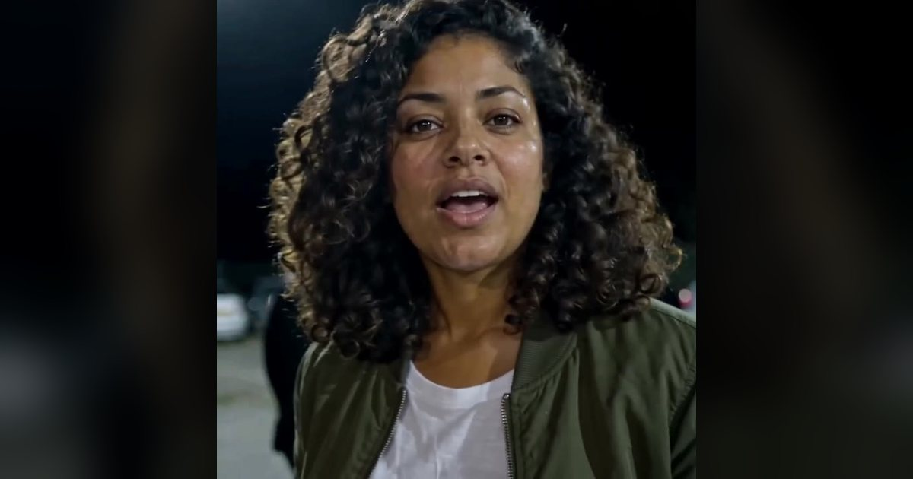

# Schooling Seniors AI 视频模板

1 张照片 → 9 秒：朋友走出画面，镜头转过来对着你，你在夜晚停车场的灯下对着镜头说唱。这个趋势也叫 The Chase Skepta 或 Lord of the Mics filter。

> A friend walks off, the camera swings to you under a car park lamp, and you rap down the lens.

## 参数

| 项 | 值 |
|---|---|
| 输入 | 1 张照片，一个成年人 |
| 时长 | 9 秒 |
| 画幅 | 1:1 方形 · 720p |
| 场景 | 固定的夜间停车场，不能换 |
| 服装 | 来自照片 |
| 音频 | 趋势原声，或静音 |
| 提示词 | 不需要写 |

**消耗**

| 版本 | 消耗 |
|---|---|
| 9 秒 | 650 积分 |

## 画面顺序

1. 画面里的朋友转身走开
2. 镜头扫过去对准你
3. 你在路灯下直视镜头说唱
4. 最后一句落下，画面结束

## 换得掉什么，换不掉什么

- **换得掉**：谁出镜、要不要声音
- **换不掉**：停车场、灯光、运镜和 9 秒的节奏

## 上传照片前先看这几条

- 嘴型跟着原声走，正脸清晰的照片效果最好
- 每张照片一个成年人：正脸、清晰、光线均匀，脸不被遮挡
- 衣服来自照片，所以腰部以上或全身照比大头自拍好；照片没拍到的部分会按同样风格补上
- 避开墨镜、口罩、帽檐压脸、重度滤镜和合照；也别用明星照或广告图，会被判侵权退回
- 不能是公众人物；上传时要勾选「已获得照片中人物的同意」
- 一般要等 10 分钟左右，可以关掉页面，做好的视频在 My videos 里

→ [在 aiMakeVideo 打开 Schooling Seniors 模板](https://aimakevideo.com/schooling-seniors-ai)

## 相关模板

- [Stormzy Shut Up](stormzy-shut-up.md) —— 一个人对着手持镜头 rap，10 秒
- [Vossi Bop](vossi-bop.md) —— 桥上 rap，镜头绕圈
- [58th Floor](58th-floor.md) —— 两个人对着同一支麦轮唱

---

[← 回到模板总览](index.md) · [积分计算器](../calculator.html) · [照片准备指南](../guide/photo-prep.md)
