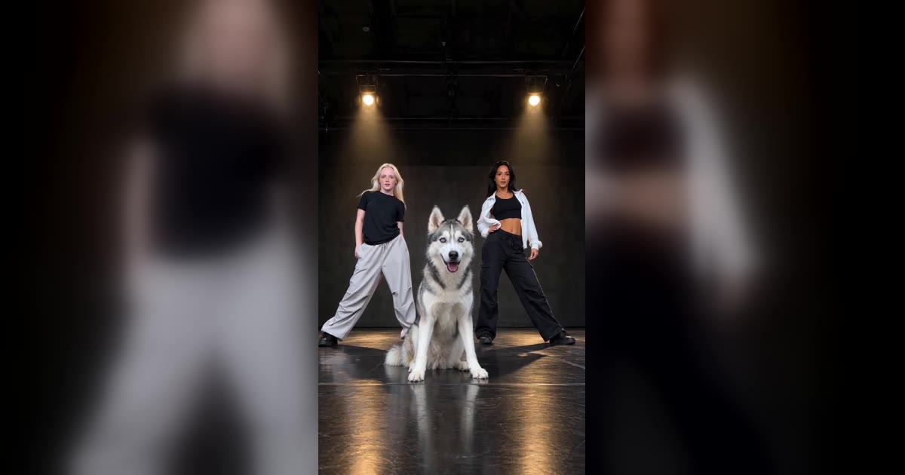

# Single Ladies Dog Dance AI 视频模板

一张宠物照 → 15 秒三人舞的 C 位：你家宠物坐在最前面，跟着节拍点头、歪头、甩头，后面两位舞者在跳。也可以换成你自己跳主舞。

> One photo of your pet, and it takes the middle spot of the sassy three-dancer routine: it sits up front and dips, tilts and tosses its head on the beat while two backup dancers work it behind.

## 参数

| 项 | 值 |
|---|---|
| 输入 | 1 张照片：一只宠物，或一个成年人 |
| 谁站 C 位 | 宠物：坐在前面用头跳舞，四脚着地；我自己：从头到脚跳主舞，两位舞者在后面半步 |
| 时长 | 15 秒 |
| 画幅 | 9:16 竖屏 · 720p |
| 场景 | 6 个预设（暗色舞蹈室、演唱会舞台、白色摄影棚、客厅、后院、霓虹街道），或上传自己的空场景照片 |
| 造型（自己跳时） | 保留照片里自己的衣服，或换上原版舞蹈造型 |
| 音频 | 参考片段的原音轨，或静音（发布时自己配乐） |
| 提示词 | 不需要写 |

**消耗**

| 分辨率 | 消耗 |
|---|---|
| 720p | 800 积分（宠物和人同价） |

## 换得掉什么，换不掉什么

- **换得掉**：C 位是宠物还是你、在哪跳、穿什么（自己跳时）、要不要声音
- **换不掉**：一主两伴的站位、手机放在地上往上拍的机位、后排舞者的动作和卡点节奏

## 上传照片前先看这几条

- **宠物**：只拍一只，清晰、光线好，脸、耳朵和身体都要拍到；品种、毛色、花纹和耳朵形状都会按照片保留
- **自己**：一个成年人，正脸、清晰、不被遮挡；保留自己衣服时要拍到腰部以上或全身
- 页面会根据照片自动判断是宠物还是人，判断错了可以手动切换
- 用自己的场景时，上传一张**从低处、贴近地面拍的空场景照片**
- 人的照片必须是成年人，且不能是公众人物；上传时要勾选「已获得照片中人物的同意」

→ [在 aiMakeVideo 打开 Single Ladies Dog Dance 模板](https://aimakevideo.com/single-ladies-dog-dance-ai)

## 相关模板

- [Dime Dime Baby](dime-dime-baby.md) —— 宠物也能跳的 8 秒派对入场
- [Baby Wow](baby-wow.md) —— 同一个派对入场梗，人和宠物都行
- [WYW My Sweetie](wyw-my-sweetie.md) —— 同样是贴地仰拍的单人舞

---

[← 回到模板总览](index.md) · [积分计算器](../calculator.html) · [照片准备指南](../guide/photo-prep.md)
