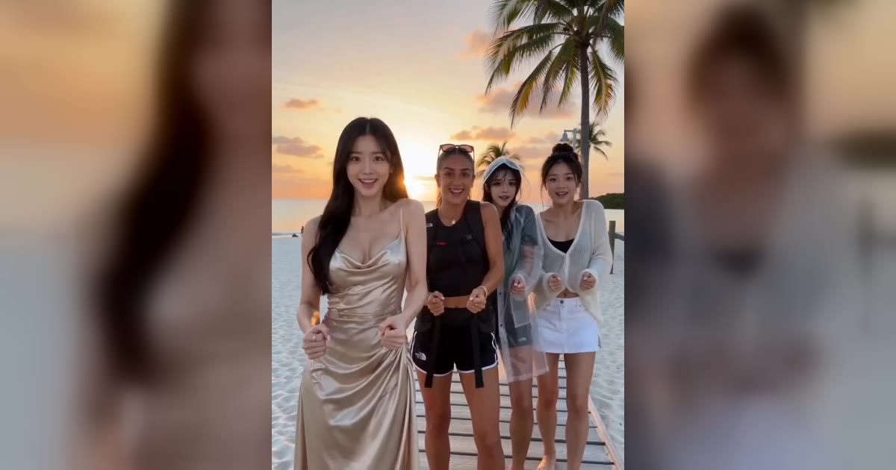

# Stereo Love Funk AI 视频模板

最多 9 张照片 → 15 秒 Funk 群舞。

> Put yourself and your friends into the routine: pick a scene, add one photo per person (up to nine) or one group photo.

## 参数

| 项 | 值 |
|---|---|
| 输入 | 每人一张照片，最多 9 张；或一张合照 |
| 时长 | 15 秒 |
| 画幅 | 9:16 竖屏 / 16:9 横屏 |
| 音频 | 可保留原声，也可静音 |
| 提示词 | 不需要写 |

**消耗**

| 分辨率 | 消耗 |
|---|---|
| 720p | 900 积分（不论几个人，都是这个价） |

## 换得掉什么，换不掉什么

- **换得掉**：每个人是谁、有几个、场景
- **换不掉**：舞步

## 上传照片前先看这几条

- 每张照片里只能有一个人（双人模板也可以只给一张双人合照）
- 正脸、光线均匀、脸完全不被遮挡
- 必须是成年人，且不能是公众人物
- 上传时要勾选「已获得照片中人物的同意」——这条是硬性要求

→ [在 aiMakeVideo 打开 Stereo Love Funk 模板](https://aimakevideo.com/stereo-love-funk-ai)

## 相关模板

- [Raindance](raindance.md) —— 8 秒短舞蹈
- [Rumpelstiltskin](rumpelstiltskin.md) —— 踮脚舞，8 秒
- [Burning Bridges](burning-bridges.md) —— 多人派对场景

---

[← 回到模板总览](index.md) · [积分计算器](../calculator.html) · [照片准备指南](../guide/photo-prep.md)
