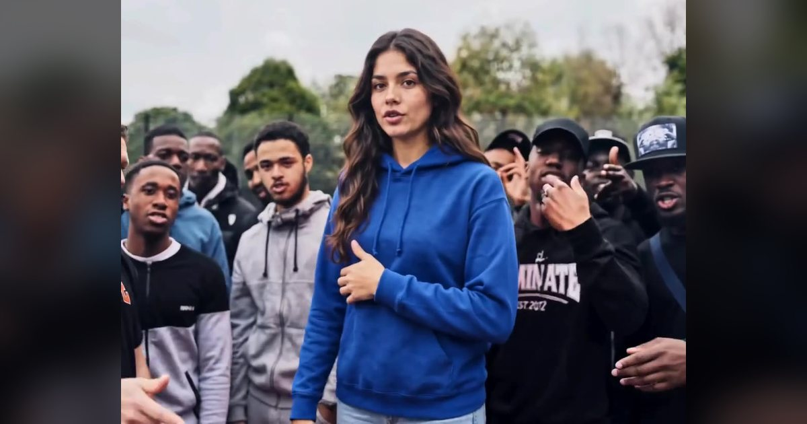

# Stormzy Shut Up AI 视频模板

1 张照片 → 10 秒：阴天的户外，一群朋友挤在你身后，背景是围栏和树，你对着手持镜头唱副歌，然后凑到镜头前，再转身走出画面。这个趋势也叫 Shut Up Stormzy AI 或「tell my man to shut up」。原型是 Stormzy 2015 年 5 月发布的户外 freestyle，伴奏是 XTC 的 grime 曲《Functions on the Low》，后来成了他的单曲《Shut Up》。AI 版 2026 年 11 月在 TikTok 流行。

> Rap the hook into a handheld camera with your friends packed in behind you.

## 参数

| 项 | 值 |
|---|---|
| 输入 | 1 张照片，一个成年人 |
| 时长 | 10 秒 |
| 画幅 | 4:3 · 720p |
| 场景 | 固定的户外场地，不能换 |
| 服装 | 来自照片 |
| 音频 | 原曲副歌、AI 配音，或静音 |
| 提示词 | 不需要写 |

**消耗**

| 版本 | 消耗 |
|---|---|
| 10 秒 | 700 积分（三种音频同价） |

## 画面顺序

1. 一群人站在围栏前，你在最前面
2. 手持镜头晃着，你开始唱副歌
3. 你往镜头前凑近
4. 转身，走出画面

## 换得掉什么，换不掉什么

- **换得掉**：谁出镜、三种音频里选一种
- **换不掉**：场地、身后的人群、手持镜头的晃动和走位

## 上传照片前先看这几条

- 选 AI 配音时，系统会先判断照片里是男声还是女声，再配相应的声音
- 每张照片一个成年人：正脸、清晰、光线均匀，脸不被遮挡
- 衣服来自照片，所以腰部以上或全身照比大头自拍好；照片没拍到的部分会按同样风格补上
- 避开墨镜、口罩、帽檐压脸、重度滤镜和合照；也别用明星照或广告图，会被判侵权退回
- 不能是公众人物；上传时要勾选「已获得照片中人物的同意」
- 一般要等 10 分钟左右，可以关掉页面，做好的视频在 My videos 里

→ [在 aiMakeVideo 打开 Stormzy Shut Up 模板](https://aimakevideo.com/stormzy-shut-up-ai)

## 相关模板

- [Vossi Bop](vossi-bop.md) —— 同一位歌手的另一首，桥上独唱
- [Schooling Seniors](schooling-seniors.md) —— 停车场夜景 rap，9 秒
- [Hotel Lobby](hotel-lobby.md) —— 两个人的 rap 对唱

---

[← 回到模板总览](index.md) · [积分计算器](../calculator.html) · [照片准备指南](../guide/photo-prep.md)
