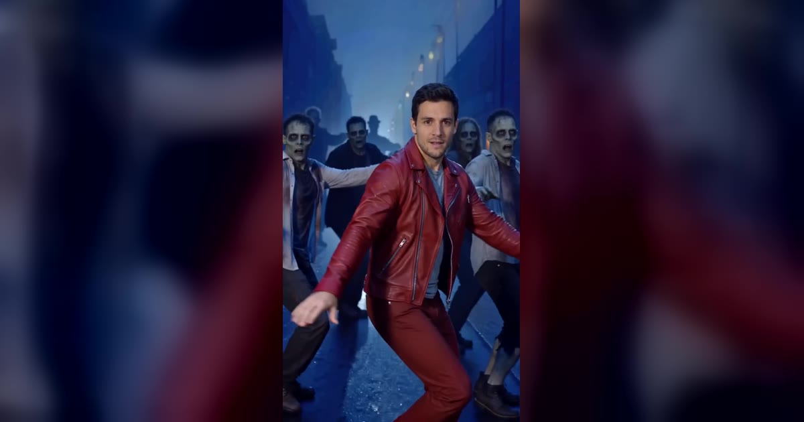

# Thriller Dance AI 视频模板

一张照片 → 15 秒丧尸群舞，你站在最前面领舞。

> Lead a street full of zombies through the Thriller dance: a close-up of your face, then the camera pulls back and the whole crowd moves with you on the beat.

## 参数

| 项 | 值 |
|---|---|
| 输入 | 1 张照片（一个成年人，正脸清楚） |
| 时长 | 15 秒 |
| 画幅 | 9:16 竖屏 · 720p |
| 造型 | 红色皮夹克，或保留照片里自己的衣服 |
| 妆面 | 自然妆，或丧尸妆（灰绿皮肤、深眼圈，仍认得出是你） |
| 音频 | 参考片段的原音轨，或静音（发布时自己配乐） |
| 提示词 | 不需要写 |

**消耗**

| 分辨率 | 消耗 |
|---|---|
| 720p | 800 积分（只有这一档） |

## 换得掉什么，换不掉什么

- **换得掉**：领舞是谁、穿红夹克还是自己的衣服、自然妆还是丧尸妆、要不要声音
- **换不掉**：一镜到底的运镜（脸部近景 → 拉远到整条街的丧尸群）、舞步和卡点、雾夜街道的场景

## 上传照片前先看这几条

- 视频开场就是脸部近景，**脸是最重要的**：正脸、清晰、光线均匀、不被遮挡
- 选红夹克时，头肩照就够；选「自己的衣服」时，照片要拍到腰部以上或全身
- 避开墨镜、口罩、不想出现在视频里的帽子、重度滤镜和合照
- 必须是成年人，且不能是公众人物
- 上传时要勾选「已获得照片中人物的同意」——这条是硬性要求

→ [在 aiMakeVideo 打开 Thriller Dance 模板](https://aimakevideo.com/thriller-dance-ai)

## 相关模板

- [Zombie](zombie.md) —— 同样是万圣节题材，两张照片的丧尸爱情故事
- [Grease Dance](grease-dance.md) —— 另一支经典舞，双人全身同框
- [Tiny Desk](tiny-desk.md) —— 1–5 张照片，办公室小型音乐会

---

[← 回到模板总览](index.md) · [积分计算器](../calculator.html) · [照片准备指南](../guide/photo-prep.md)
