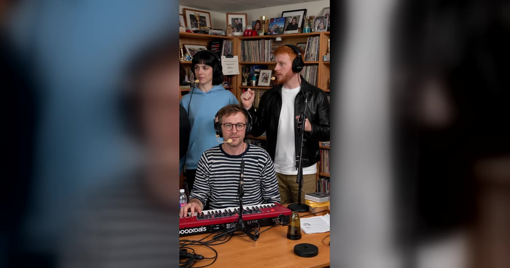

# Tiny Desk AI 视频模板

1–5 张照片 → 19 秒办公室小型音乐会，乐队换成你的人。

> Make the Outstanding Tiny Desk set with your own band: the lead singer in close-up, the band squeezed behind the desk, a sax solo, then the band again.

## 参数

| 项 | 值 |
|---|---|
| 输入 | 1–5 张照片：主唱必填，键盘、萨克斯、左右两位和声可选 |
| 时长 | 19 秒 |
| 画幅 | 9:16 竖屏 |
| 音频 | 参考片段的原音轨，或静音（发布时自己配乐） |
| 提示词 | 不需要写 |

**消耗**

| 分辨率 | 消耗 |
|---|---|
| 720p | 900 积分 |
| 1080p | 1,350 积分 |

不论上传几张照片，都是这个价。

## 谁演什么

| 位置 | 在视频里 |
|---|---|
| 主唱（必填） | 开场近景，中段再来一个长近景，笑着唱副歌 |
| 键盘 | 两个全景镜头里坐在正中间，萨克斯独奏时在画面一角 |
| 萨克斯 | 中段的独奏镜头 |
| 左 / 右和声 | 站在桌子后面，唱歌、挥拳 |

- **空着的位置由 AI 乐手补上**，而且每个镜头里都是同一个人
- 主唱和键盘手**从不同时出现在画面里**，所以只给一张照片时，你会同时演主唱和键盘，每个镜头都有你

## 换得掉什么，换不掉什么

- **换得掉**：乐队里是谁、来几个人、720p 还是 1080p、要不要声音
- **换不掉**：5 个镜头的剪辑点和节奏（近景、全景、萨克斯独奏）、堆满乐器和书架的办公室场景

## 上传照片前先看这几条

- 一张照片只有一个人，正脸、清晰、光线均匀
- **主唱的照片最重要**：近景很大，脸糊了一眼就能看出来
- 照片里穿什么，视频里就穿什么，挑一套愿意「上台」的衣服
- 避开墨镜、帽子、重度滤镜、合照和截图；JPG / PNG / WebP，最大 10 MB
- 必须是成年人，且不能是公众人物；上传时要勾选「已获得照片中人物的同意」

→ [在 aiMakeVideo 打开 Tiny Desk 模板](https://aimakevideo.com/tiny-desk-ai)

## 相关模板

- [Stereo Love Funk](stereo-love-funk.md) —— 最多 9 个人的群舞
- [Thriller Dance](thriller-dance.md) —— 一张照片领舞丧尸群
- [Grease Dance](grease-dance.md) —— 双人舞，1–2 张照片

---

[← 回到模板总览](index.md) · [积分计算器](../calculator.html) · [照片准备指南](../guide/photo-prep.md)
