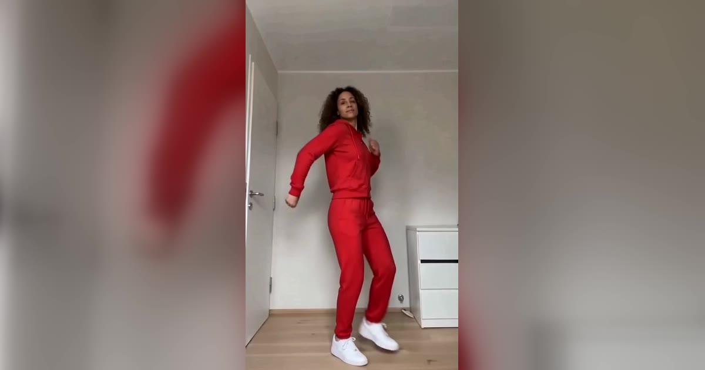

# Toc Toc Dance AI 视频模板

一张照片 → 10 秒面无表情的 Toc Toc 舞：单脚跳、踢膝、转身，最后张开双臂。

> Put yourself in the deadpan Toc Toc routine everyone is reposting: the one-foot hops, the knee kicks, the turns and the trend's own sound, in the room you pick.

## 参数

| 项 | 值 |
|---|---|
| 输入 | 1 张照片（一个成年人，最好是全身照） |
| 时长 | 10 秒 |
| 画幅 | 9:16 竖屏 · 720p |
| 场景 | 6 个房间，每个画面里都有一扇门（原版白色房间、70 年代客厅、酒店走廊、后台化妆间、办公室茶水间、黄昏天台） |
| 音频 | 参考片段的原音轨，或静音（发布时自己配乐） |
| 提示词 | 不需要写 |

**消耗**

| 分辨率 | 消耗 |
|---|---|
| 720p | 600 积分 |

## 换得掉什么，换不掉什么

- **换得掉**：谁来跳（脸、发型、肤色、体型、衣服和鞋都来自照片）、在哪个房间、要不要声音
- **换不掉**：10 秒的固定舞步、机位和节奏

## 上传照片前先看这几条

- **全身照最好**：舞步需要完整的人，照片里没拍到的部分，模型没法保留
- 正脸、手和鞋都要露出来，背景越简单越好
- 避开墨镜、口罩、重度滤镜、合照，以及身体被截掉一部分的照片
- 必须是成年人，且不能是公众人物；上传时要勾选「已获得照片中人物的同意」

→ [在 aiMakeVideo 打开 Toc Toc 模板](https://aimakevideo.com/toc-toc-dance-ai)

## 相关模板

- [WYW My Sweetie](wyw-my-sweetie.md) —— 19 秒单人舞，可选场景和造型
- [Dime Dime Baby](dime-dime-baby.md) —— 8 秒派对入场，人和宠物都能跳
- [Rumpelstiltskin](rumpelstiltskin.md) —— 8 秒单图模板

---

[← 回到模板总览](index.md) · [积分计算器](../calculator.html) · [照片准备指南](../guide/photo-prep.md)
