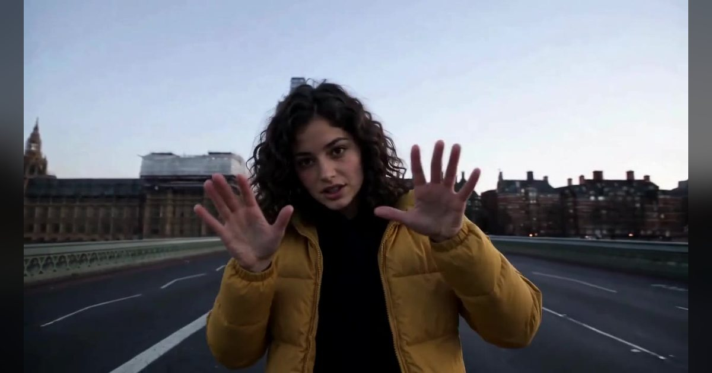

# Vossi Bop AI 视频模板

1 张照片 → 11 秒：清晨空无一人的威斯敏斯特桥上，你一个人唱副歌，镜头绕着你转，身后是伦敦眼、国会大厦和搭着脚手架的大本钟，最后你双手张开举到脸旁，正对镜头。原型是 Stormzy《Vossi Bop》MV 的开头（2019 年 4 月，导演 Henry Scholfield），那是他第一首英国冠军单曲。AI 版 2026 年秋天在 TikTok 流行。

> Rap the chorus alone on an empty Westminster Bridge at dawn while the camera circles you.

## 参数

| 项 | 值 |
|---|---|
| 输入 | 1 张照片，一个成年人 |
| 时长 | 11 秒 |
| 画幅 | 16:9 横屏 · 720p |
| 场景 | 固定的清晨大桥，不能换 |
| 服装 | 来自照片 |
| 音频 | 原曲副歌，或静音 |
| 提示词 | 不需要写 |

**消耗**

| 版本 | 消耗 |
|---|---|
| 11 秒 | 800 积分 |

## 画面顺序

1. 空桥上你一个人站着，镜头开始绕
2. 你跟着副歌开口
3. 身后的地标随着绕镜转过去
4. 双手张开举到脸旁，定在镜头前

## 换得掉什么，换不掉什么

- **换得掉**：谁出镜、要不要声音
- **换不掉**：大桥、清晨的光线、绕镜的轨迹和结尾的手势

## 上传照片前先看这几条

- 绕镜会拍到侧脸，所以正脸清晰、光线均匀的照片更稳
- 每张照片一个成年人：正脸、清晰、光线均匀，脸不被遮挡
- 衣服来自照片，所以腰部以上或全身照比大头自拍好；照片没拍到的部分会按同样风格补上
- 避开墨镜、口罩、帽檐压脸、重度滤镜和合照；也别用明星照或广告图，会被判侵权退回
- 不能是公众人物；上传时要勾选「已获得照片中人物的同意」
- 一般要等 10 分钟左右，可以关掉页面，做好的视频在 My videos 里

→ [在 aiMakeVideo 打开 Vossi Bop 模板](https://aimakevideo.com/vossi-bop-ai)

## 相关模板

- [Stormzy Shut Up](stormzy-shut-up.md) —— 同一位歌手的另一首，10 秒
- [Schooling Seniors](schooling-seniors.md) —— 停车场夜景 rap，9 秒
- [Birds of a Feather](birds-of-a-feather.md) —— 转椅房间里的独唱，13 秒

---

[← 回到模板总览](index.md) · [积分计算器](../calculator.html) · [照片准备指南](../guide/photo-prep.md)
