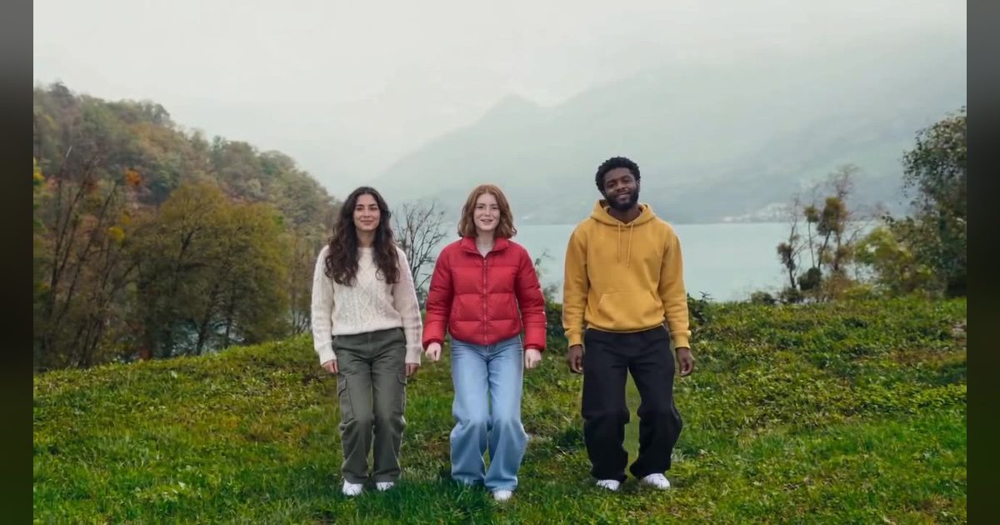

# Wassup in a Minute AI 视频模板

1–3 张照片，或 1 张合照 → 15 秒：三个朋友在湖边雾蒙蒙的绿色山坡上跳 2026 年 10 月流行的「wassup in a minute」。先是三个人朝镜头跳过来；切到中间那个人对着镜头唱的近景，另外两个在远处跳；三个人并排走过来、抖肩；最后一个广角，三个人散开在草坡上各跳各的。

> Three friends, one hillside, a lake in the mist behind you.

## 参数

| 项 | 值 |
|---|---|
| 输入 | 1–3 张照片，或 1 张合照（最多识别 3 张脸，从左到右分配）；中间位必填，左右空位由固定的 AI 朋友补上，也可以三个位置都是你 |
| 时长 | 15 秒 |
| 画幅 | 16:9 横屏 · 480p / 720p |
| 场景 | 固定的湖边山坡，不能换 |
| 服装 | 来自照片，不是原片的衣服 |
| 音频 | 趋势原声，或静音 |
| 提示词 | 不需要写 |

**消耗**

| 版本 | 消耗 |
|---|---|
| 480p | 395 积分 |
| 720p | 870 积分 |

## 画面顺序

1. 中景：三个人朝镜头跳过来
2. 近景：中间那个人对着镜头唱，另外两个在远处跳
3. 三个人并排走向镜头，边走边抖肩
4. 广角：三个人散开在草坡上，各自 freestyle

## 换得掉什么，换不掉什么

- **换得掉**：三个位置分别是谁、一个人分饰三角、有声还是静音、480p 还是 720p
- **换不掉**：山坡、湖、手持镜头和四个硬切

## 上传照片前先看这几条

- 中间那个人有唱歌的近景，放脸最清楚的一张
- 每张照片一个成年人：正脸、清晰、光线均匀、不被遮挡；用合照的话，每张脸都要看得清
- 衣服来自照片，原片的衣服不会出现
- 避开墨镜、帽子、口罩、重度滤镜和明星照
- 照片的背景不会进视频
- 只限成年人；一般要等几分钟，做好的视频在 My videos 里

→ [在 aiMakeVideo 打开 Wassup in a Minute 模板](https://aimakevideo.com/wassup-in-a-minute-ai)

## 相关模板

- [No Scrubs](no-scrubs.md) —— 三个朋友在银色太空站里跳
- [Gangnam Style](gangnam-style.md) —— 固定 3 个人的合唱
- [Stereo Love Funk](stereo-love-funk.md) —— 最多 9 个人

---

[← 回到模板总览](index.md) · [积分计算器](../calculator.html) · [照片准备指南](../guide/photo-prep.md)
