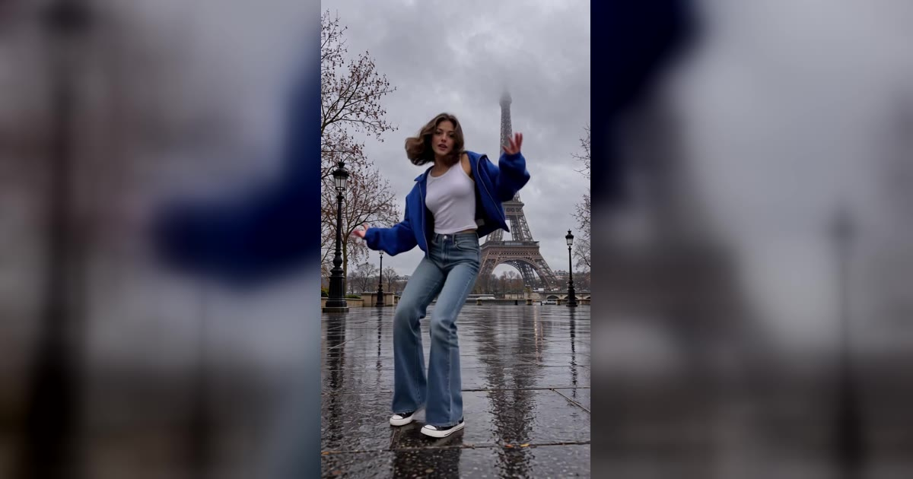

# WYW My Sweetie Dance AI 视频模板

一张照片 → 19 秒 jersey club 独舞，手机放地上仰拍，最后走到镜头前来个近景。

> One photo in, the bouncy jersey-club dance out: the whole routine head to toe, filmed from a phone on the floor, then a walk up to the lens for a close-up.

## 参数

| 项 | 值 |
|---|---|
| 输入 | 1 张照片（一个成年人，正脸清楚） |
| 时长 | 19 秒 |
| 画幅 | 9:16 竖屏 · 720p |
| 场景 | 6 个预设（家里走廊、雨中埃菲尔铁塔、霓虹街道、日落天台、卧室、篮球场），或上传自己的空场景照片 |
| 造型 | 蓝色短夹克 + 白背心 + 喇叭牛仔裤；条纹长袖 + 宽松裤；或保留照片里自己的衣服 |
| 音频 | 参考片段的原音轨，或静音（发布时自己配乐） |
| 提示词 | 不需要写 |

**消耗**

| 分辨率 | 消耗 |
|---|---|
| 720p | 900 积分（不论选哪个场景、造型） |

## 换得掉什么，换不掉什么

- **换得掉**：谁来跳、在哪跳、穿什么、要不要声音
- **换不掉**：舞步（弹跳、抬膝、摆臂）、手机放在地上往上拍的机位、结尾走到镜头前的近景、卡点节奏

## 上传照片前先看这几条

- 整段视频都是你，从全身到结尾的脸部近景，所以正脸、清晰、光线均匀最重要
- 选「自己的衣服」时，照片要拍到腰部以上或全身
- 用自己的场景时，上传一张**从低处、贴近地面拍的空场景照片**，地面从画面底部往后延伸的效果最好
- 避开墨镜、口罩、重度滤镜和合照
- 必须是成年人，且不能是公众人物；上传时要勾选「已获得照片中人物的同意」

→ [在 aiMakeVideo 打开 WYW My Sweetie 模板](https://aimakevideo.com/wyw-my-sweetie-dance-ai)

## 相关模板

- [Toc Toc](toc-toc.md) —— 另一支单人舞，10 秒
- [Grease Dance](grease-dance.md) —— 同样可选场景和造型的双人舞
- [Thriller Dance](thriller-dance.md) —— 一张照片领舞丧尸群

---

[← 回到模板总览](index.md) · [积分计算器](../calculator.html) · [照片准备指南](../guide/photo-prep.md)
