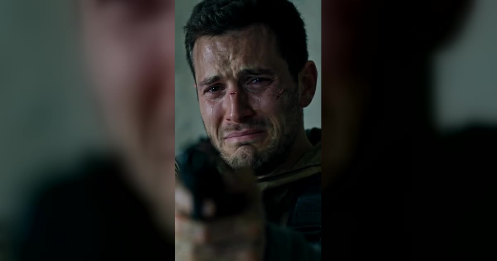

# Zombie AI 视频模板

两张照片 → 12 秒丧尸爱情故事。

> Turn two photos into a zombie love story: a tense encounter, an embrace, then a sunny memory.

## 参数

| 项 | 值 |
|---|---|
| 输入 | 2 张照片（一张人类、一张丧尸） |
| 时长 | 12 秒 |
| 画幅 | 9:16 竖屏 / 16:9 横屏 |
| 音频 | 带声音 |
| 提示词 | 不需要写 |

**消耗**

| 分辨率 | 消耗 |
|---|---|
| 480p | 372 积分 |
| 720p | 819 积分 |

## 换得掉什么，换不掉什么

- **换得掉**：两个人是谁、竖屏还是横屏
- **换不掉**：三段剧情结构

## 上传照片前先看这几条

- 每张照片里只能有一个人（双人模板也可以只给一张双人合照）
- 正脸、光线均匀、脸完全不被遮挡
- 必须是成年人，且不能是公众人物
- 上传时要勾选「已获得照片中人物的同意」——这条是硬性要求

→ [在 aiMakeVideo 打开 Zombie 模板](https://aimakevideo.com/zombie-ai)

---

[← 回到模板总览](index.md) · [积分怎么算](../credits.md)
